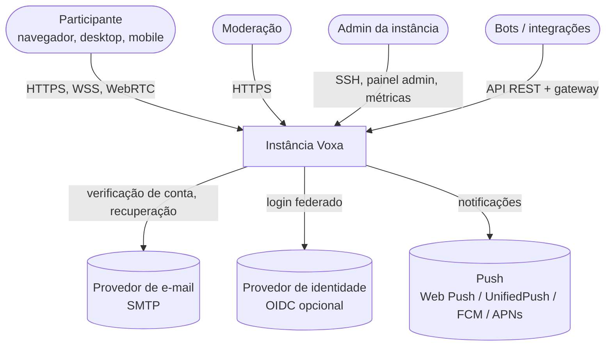
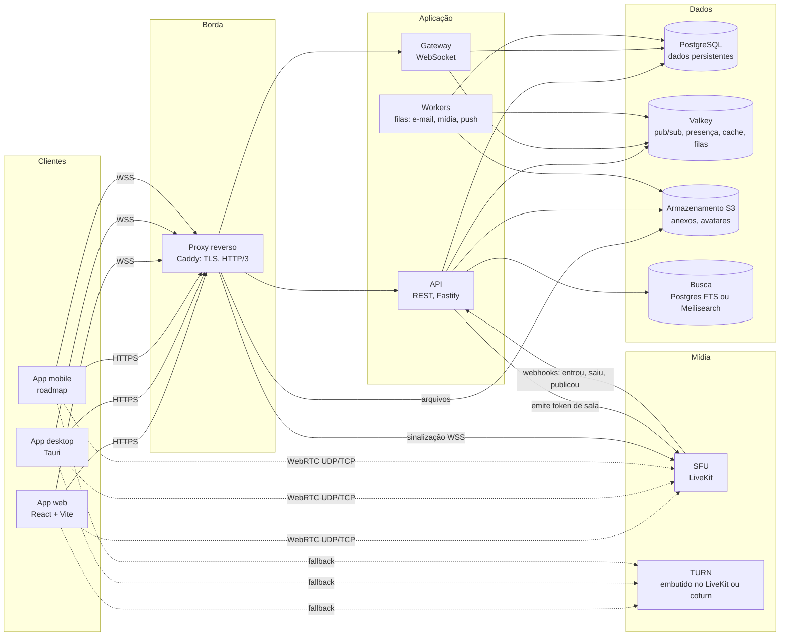
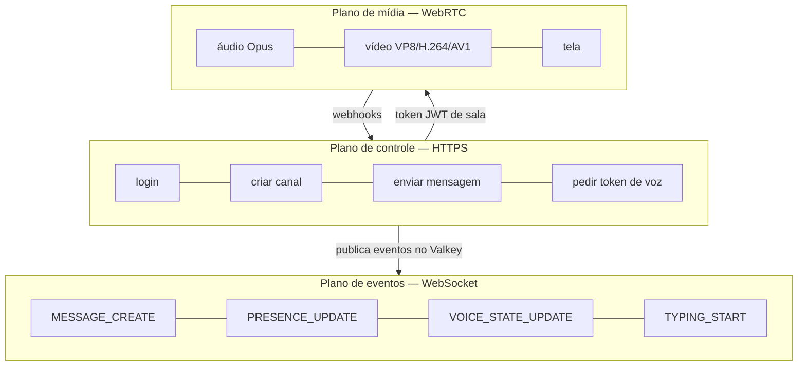
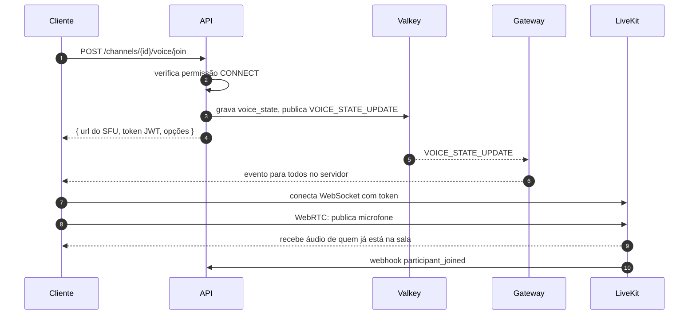

# 2. Arquitetura

> Status: **Proposta v0.1** — as escolhas de tecnologia estão registradas nos [ADRs](adr/README.md).

## 2.1 Contexto

Quem interage com o Voxa e com quais sistemas externos ele conversa.

## 2.2 Contêineres (serviços)

### Responsabilidades

| Serviço | Faz | Não faz |
|---|---|---|
| **API** | Autenticação, CRUD de servidores/canais/mensagens, permissões, upload assinado, emissão de tokens de mídia | Manter conexões longas |
| **Gateway** | Mantém um WebSocket por sessão; entrega eventos (mensagens, presença, estado de voz) filtrados por permissão | Escrever no banco (exceto sessão) |
| **Workers** | Tarefas assíncronas: miniaturas, varredura de arquivos, e-mails, push, limpeza | Atender requisições do cliente |
| **SFU (LiveKit)** | Recebe e repassa áudio, vídeo e tela; simulcast; controle de banda; E2EE de quadros | Decidir quem pode entrar (isso vem do token da API) |
| **TURN** | Retransmite mídia quando UDP direto é bloqueado (redes corporativas, CGNAT) | — |
| **PostgreSQL** | Fonte da verdade | — |
| **Valkey** | Barramento de eventos entre API e gateways, presença, estado de voz efêmero, rate limit, filas | Dados que não podem ser perdidos |

## 2.3 Princípio central: três planos separados

- **Escrita sempre por HTTPS.** O cliente nunca altera estado pelo WebSocket (exceto presença e digitação, que são efêmeros). Isso simplifica autorização, idempotência e testes.
- **Leitura em tempo real pelo gateway.** Toda mudança vira um evento publicado no Valkey; cada gateway entrega somente às sessões interessadas e autorizadas.
- **Mídia direto no SFU.** O tráfego pesado nunca passa pela API nem pelo gateway.

## 2.4 Exemplo de ponta a ponta: entrar numa sala de voz

Detalhes em [Voz](06-voz.md).

## 2.5 Escalabilidade

| Componente | Como escala | Estado |
|---|---|---|
| API | Horizontal, sem estado | Nenhum local |
| Gateway | Horizontal; sessões fixadas por conexão; eventos via Valkey pub/sub | Sessão em memória + `resume` via Valkey |
| Workers | Horizontal por fila | Nenhum local |
| SFU | Múltiplos nós LiveKit com roteamento por sala (Valkey) | Por sala |
| PostgreSQL | Vertical → réplicas de leitura → particionamento de `messages` por canal/tempo | — |
| Valkey | Vertical → Sentinel/cluster | — |

Detalhes e topologias em [Infraestrutura](03-infraestrutura.md).

## 2.6 Tecnologias propostas

| Camada | Escolha | Licença | ADR |
|---|---|---|---|
| Linguagem (backend e cliente) | TypeScript | Apache-2.0 | [0002](adr/0002-typescript-monorepo.md) |
| API | Node.js 24 LTS + Fastify | MIT | [0002](adr/0002-typescript-monorepo.md) |
| Gateway | Node.js + `ws` (ou uWebSockets.js se precisar) | MIT / Apache-2.0 | [0002](adr/0002-typescript-monorepo.md) |
| Mídia | LiveKit Server | Apache-2.0 | [0003](adr/0003-livekit-como-sfu.md) |
| Banco | PostgreSQL 17 | PostgreSQL | [0004](adr/0004-postgres-e-valkey.md) |
| Cache/pub-sub | Valkey 8 | BSD-3 | [0004](adr/0004-postgres-e-valkey.md) |
| Objetos | Qualquer S3 (Garage, SeaweedFS, MinIO, provedor) | — | [0005](adr/0005-armazenamento-s3.md) |
| Web | React 19 + Vite + TanStack Router | MIT | [0006](adr/0006-cliente-react-tauri.md) |
| Desktop | Tauri 2 | MIT / Apache-2.0 | [0006](adr/0006-cliente-react-tauri.md) |
| Proxy | Caddy | Apache-2.0 | [0007](adr/0007-implantacao.md) |
| Observabilidade | Prometheus, Grafana, Loki, OpenTelemetry | Apache-2.0 / AGPL-3.0 | [0007](adr/0007-implantacao.md) |
