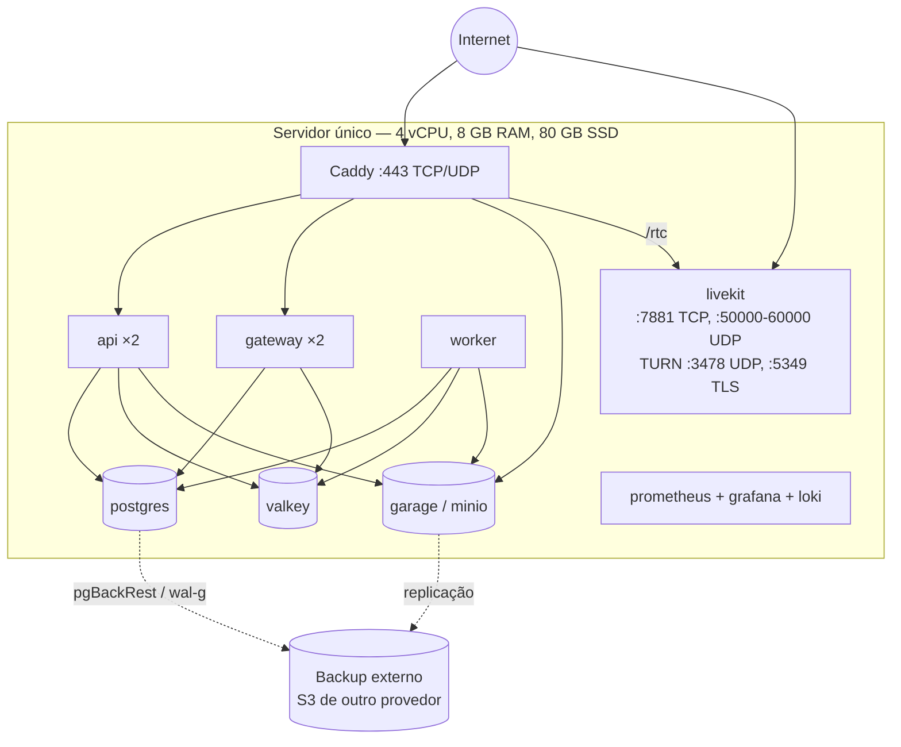
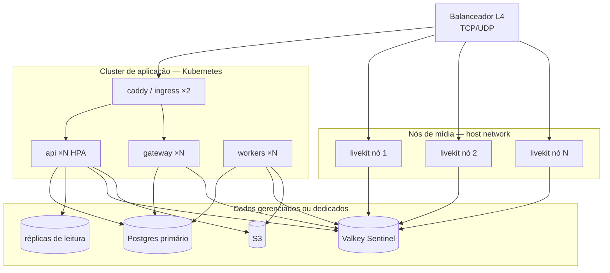
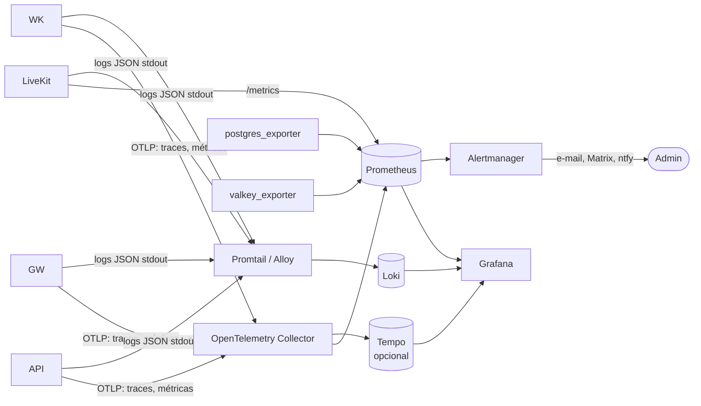

# 3. Infraestrutura

Este documento é para quem vai **hospedar** uma instância. Ele cobre topologias, rede, armazenamento, backup, observabilidade, atualização e custos.

## 3.1 Topologias suportadas

### A. Nó único (padrão — até ~200 pessoas simultâneas em voz)

Tudo num servidor, orquestrado com Docker Compose.



### B. Escalada (milhares de pessoas simultâneas)



- Os nós LiveKit rodam com `hostNetwork` (ou em VMs dedicadas): mídia UDP não deve atravessar NAT do cluster.
- LiveKit usa o Valkey para saber em qual nó cada sala está; a API só emite o token, o cliente é direcionado ao nó certo.
- Mídia pode ficar **geograficamente distribuída** (um nó LiveKit por região) com o restante centralizado.

## 3.2 Rede e portas

| Porta | Protocolo | Serviço | Pública? | Observação |
|---|---|---|---|---|
| 80 | TCP | Caddy | sim | Só redireciona para 443 e emite certificados ACME |
| 443 | TCP + UDP | Caddy | sim | HTTPS, WSS, HTTP/3 (QUIC) |
| 7880 | TCP | LiveKit API/sinalização | **não** | Exposta via Caddy em `/rtc` |
| 7881 | TCP | LiveKit ICE/TCP | sim | Fallback quando UDP está bloqueado |
| 50000–60000 | UDP | LiveKit RTP | sim | Mídia; reduza a faixa em instâncias pequenas |
| 3478 | UDP | TURN | sim | Redes restritivas |
| 5349 | TCP | TURN/TLS | sim | Redes que só permitem TLS (pode usar 443 num IP dedicado) |
| 5432, 6379, 3900 | TCP | Postgres, Valkey, S3 | **não** | Somente rede interna |

### DNS

| Registro | Aponta para |
|---|---|
| `voxa.exemplo.org` | Caddy (app web + API + gateway) |
| `rtc.voxa.exemplo.org` | Caddy → LiveKit (sinalização) |
| `turn.voxa.exemplo.org` | IP do LiveKit (TURN/TLS precisa de certificado próprio) |
| `cdn.voxa.exemplo.org` | S3 público (avatares, anexos via URL assinada) |

### Rotas do proxy

```
voxa.exemplo.org
├── /              → arquivos estáticos do app web (SPA)
├── /api/v1/*      → api:3000
├── /gateway       → gateway:4000   (upgrade WebSocket)
└── /health        → api:3000/health
rtc.voxa.exemplo.org → livekit:7880
cdn.voxa.exemplo.org → s3:3900      (somente leitura, cache agressivo)
```

## 3.3 Armazenamento

| Dado | Onde | Retenção | Backup |
|---|---|---|---|
| Contas, servidores, canais, cargos | Postgres | Permanente | Contínuo (WAL) + diário |
| Mensagens | Postgres (particionado por mês) | Configurável por servidor | Contínuo + diário |
| Anexos, avatares, emojis | S3 | Até o dono apagar | Replicação para outro provedor |
| Presença, estado de voz, sessões do gateway | Valkey | Efêmero (TTL) | Não precisa |
| Filas de tarefas | Valkey (streams) | Até processar | Não precisa |
| Logs | Loki | 14 dias (padrão) | Não |
| Métricas | Prometheus | 30 dias | Não |
| **Mídia de chamadas** | **Nenhum lugar** | Não é gravada | — |

> Gravação de chamadas não existe por padrão. Se for implementada (roadmap), será opt-in por sala, com aviso visível a todos os participantes.

## 3.4 Backup e recuperação

- **Postgres:** `pgBackRest` ou `wal-g` com WAL contínuo para um S3 **de outro provedor**; *full* semanal, diferencial diário. Meta: RPO ≤ 5 min, RTO ≤ 1 h.
- **S3:** replicação assíncrona ou `rclone sync` noturno.
- **Teste de restauração mensal** automatizado (job que restaura num contêiner descartável e roda verificações).
- **Segredos** (`.env`, chaves LiveKit, chave de assinatura de tokens) ficam fora do backup de dados, num cofre (ex.: `sops` + `age`, ou Vaultwarden da organização).

## 3.5 Observabilidade



### Indicadores principais (SLIs)

| Indicador | Meta (SLO) |
|---|---|
| Disponibilidade da API (`2xx+4xx / total`) | ≥ 99,5 % / mês |
| Latência p95 de `POST /messages` | < 300 ms |
| Tempo p95 entre `POST /messages` e entrega no gateway | < 500 ms |
| Tempo p95 para entrar numa sala de voz | < 2 s |
| Perda de pacotes média nas chamadas | < 2 % |
| Sessões de gateway reconectadas com `resume` bem-sucedido | ≥ 95 % |

### Alertas mínimos

- Disco > 80 %; backup sem sucesso há > 26 h; réplica atrasada > 60 s.
- Taxa de erro 5xx > 2 % por 5 min.
- CPU do LiveKit > 80 % (cada nó tem um teto de participantes).
- Certificado TLS expira em < 14 dias.

**Privacidade:** logs nunca registram conteúdo de mensagens, tokens ou IPs completos (IP truncado em /24 ou /48). Ver [Segurança](09-seguranca-e-privacidade.md).

## 3.6 Instalação (nó único)

> Os arquivos citados (`infra/compose/…`) serão criados na Fase 0 do [Roadmap](11-roadmap.md).

```bash
git clone https://github.com/devballao/voxa.git && cd voxa/infra/compose
cp .env.example .env              # domínio, e-mail ACME, SMTP
./scripts/gerar-segredos.sh       # chaves LiveKit, assinatura JWT, senhas internas
docker compose up -d
docker compose exec api voxa-admin migrate
docker compose exec api voxa-admin create-admin --email voce@exemplo.org
```

Requisitos: Linux com Docker 24+, IP público, portas da seção 3.2 abertas, domínio com DNS configurado.

### Imagens Docker

O CI publica uma imagem por serviço no GitHub Container Registry a cada merge na `main` ([`infra/docker`](../infra/docker/README.md)):

| Imagem | Conteúdo | Saúde (`HEALTHCHECK`) |
|---|---|---|
| `ghcr.io/devballao/voxa-api` | API (Node 24, Alpine) e o comando de migrações | `GET /api/v1/health` |
| `ghcr.io/devballao/voxa-gateway` | Gateway WebSocket | `GET /health` |
| `ghcr.io/devballao/voxa-worker` | Consumidores de filas | processo ativo |
| `ghcr.io/devballao/voxa-web` | App web estático servido pelo Caddy (porta 80) | `GET /` |

- **Tags:** `sha-<commit>` (fixa, para voltar a uma versão exata) e `main` (a mais recente).
- **Arquiteturas:** `linux/amd64` e `linux/arm64` (servidores ARM, como o Oracle Always Free).
- Os serviços rodam como o usuário `node`, sem privilégios, e escutam em `0.0.0.0` dentro do contêiner.
- Migrações: `docker run --rm --env-file .env ghcr.io/devballao/voxa-api:main node node_modules/@voxa/db/dist/cli/migrate.js`.

### Atualização

```bash
git pull && docker compose pull
docker compose exec api voxa-admin migrate --check   # mostra migrações pendentes
docker compose up -d                                 # rolling: api/gateway sobem antes de derrubar os antigos
```

- Versionamento semântico; migrações de banco sempre **compatíveis com a versão anterior** (expandir → migrar → contrair), para permitir atualização sem parada.
- O gateway envia `RECONNECT` aos clientes antes de desligar; eles retomam a sessão em outro nó.

## 3.7 Dimensionamento e custo

### Banda de mídia (o que mais pesa)

Num SFU, cada participante **envia 1** fluxo e **recebe N−1**.

| Fluxo | Taxa típica |
|---|---|
| Voz Opus | 32–64 kbit/s |
| Câmera 720p (simulcast, 3 camadas) | envia ~1,7 Mbit/s; recebe 150 kbit/s–1,2 Mbit/s por pessoa |
| Tela 1080p30 | 2,5–4 Mbit/s |
| Tela 1080p60 / 1440p60 | 5–8 Mbit/s |

**Saída do servidor ≈ Σ por sala de (N × (N−1) × taxa por fluxo)**, mais transmissões × espectadores.

Exemplo: 20 salas de 6 pessoas só com voz a 48 kbit/s → 20 × 6 × 5 × 48 kbit/s ≈ **29 Mbit/s** de saída. Uma tela 1080p30 assistida por 30 pessoas → 30 × 3 Mbit/s ≈ **90 Mbit/s**.

### Faixas de servidor (estimativa, a validar com testes de carga)

| Porte | Pessoas simultâneas em voz | Máquina sugerida | Rede |
|---|---|---|---|
| Pequeno | até 200 | 4 vCPU / 8 GB | 1 Gbit/s, tráfego ilimitado ou alto |
| Médio | até 1 000 | App 8 vCPU + LiveKit 2× 8 vCPU | 1 Gbit/s por nó de mídia |
| Grande | 5 000+ | Kubernetes + nós de mídia por região | — |

> Prefira provedores com **tráfego de saída incluído** — em nuvens que cobram por GB, a mídia domina a conta. Para projetos sem fins lucrativos, vale buscar programas de crédito para ONGs e projetos de código aberto e hospedagem doada por universidades.

### Limites configuráveis pela instância

Como a qualidade **não** depende de assinatura, o admin define os tetos conforme a capacidade:

```yaml
# infra/compose/voxa.yaml (proposta)
media:
  max_participants_per_room: 25
  screen_share:
    max_resolution: 1080   # 720 | 1080 | 1440 | source
    max_fps: 30            # 15 | 30 | 60
    max_concurrent_per_room: 2
  camera:
    max_resolution: 720
uploads:
  max_file_size_mb: 50
```
