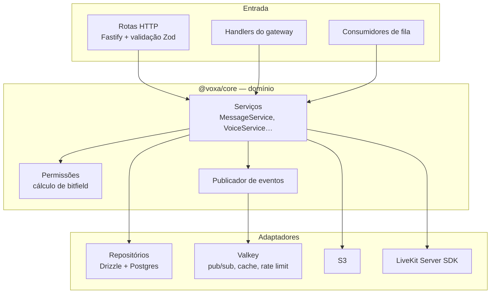
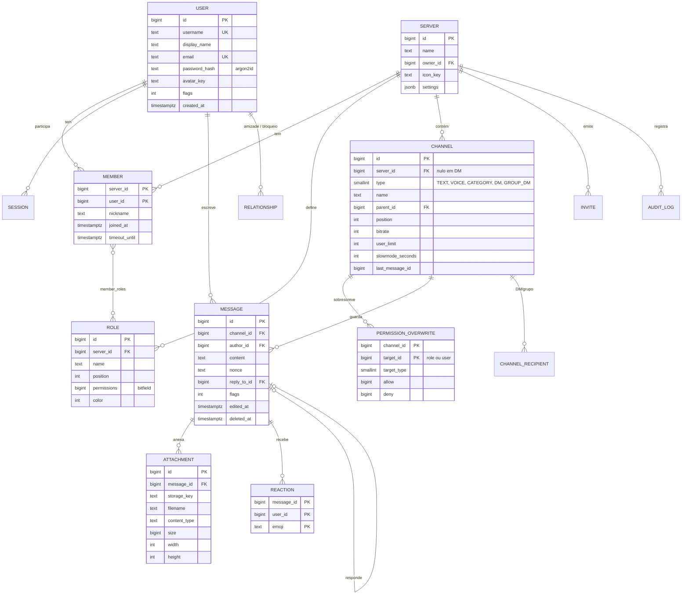
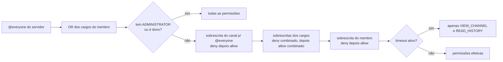
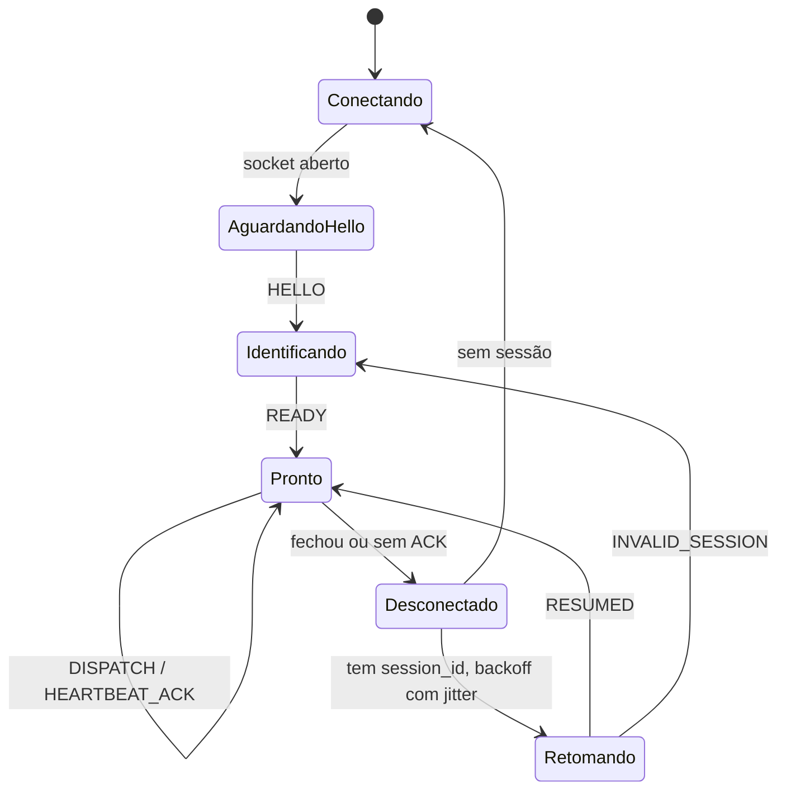
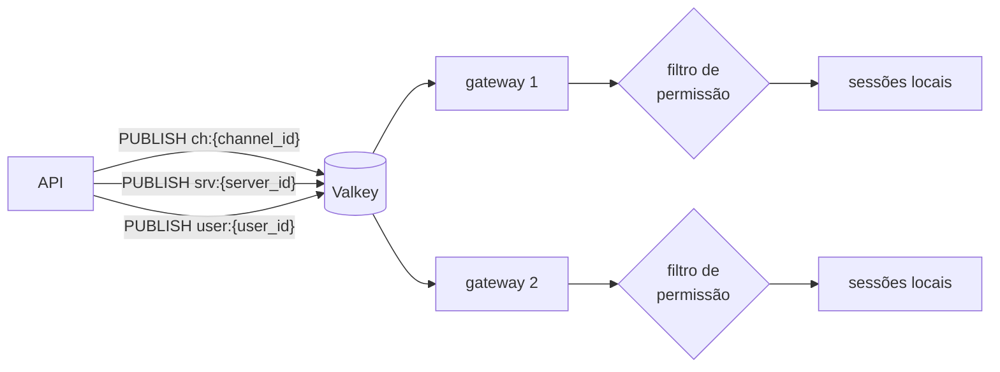

# 4. Backend

Três processos compartilham o mesmo código de domínio (pacote `@voxa/core`): **API**, **Gateway** e **Workers**. Ver a organização do repositório em [Desenvolvimento](10-desenvolvimento.md).

## 4.1 Camadas internas



Regras: rotas não acessam o banco diretamente; serviços não conhecem HTTP; todo efeito colateral relevante gera um **evento de domínio** que é publicado *depois* do commit da transação (padrão *transactional outbox*, tabela `outbox` lida por um worker).

## 4.2 Identificadores

Todas as entidades usam **Snowflake** de 64 bits, serializado como **string** no JSON (JavaScript perde precisão acima de 2⁵³).

```
 63                      22 21       12 11          0
┌─────────────────────────┬───────────┬─────────────┐
│ ms desde 2025-01-01 (42)│ worker(10)│ sequência(12)│
└─────────────────────────┴───────────┴─────────────┘
```

- Ordenável por tempo → paginação de mensagens por `id` sem índice extra de data.
- `worker` é atribuído a cada processo na inicialização (lease no Valkey).

## 4.3 Modelo de dados



**Não ficam no Postgres** (Valkey, com TTL): presença (`online/idle/dnd/offline`), estado de voz (`voice_state:{server}:{user}`), indicador "digitando", sessões do gateway para `resume`.

### Particionamento

`messages` é particionada por **intervalo de `id`** (equivale a meses). Índice principal: `(channel_id, id DESC)`. Isso mantém as consultas de histórico (`WHERE channel_id = $1 AND id < $2 ORDER BY id DESC LIMIT 50`) rápidas mesmo com bilhões de linhas.

## 4.4 Permissões

Bitfield de 64 bits, calculado em camadas:



| Bit | Permissão | Bit | Permissão |
|---|---|---|---|
| 0 | `VIEW_CHANNEL` | 10 | `CONNECT` (voz) |
| 1 | `SEND_MESSAGES` | 11 | `SPEAK` |
| 2 | `READ_HISTORY` | 12 | `VIDEO` (câmera) |
| 3 | `ATTACH_FILES` | 13 | `SCREEN_SHARE` |
| 4 | `ADD_REACTIONS` | 14 | `MUTE_MEMBERS` |
| 5 | `MENTION_EVERYONE` | 15 | `MOVE_MEMBERS` |
| 6 | `MANAGE_MESSAGES` | 16 | `PRIORITY_SPEAKER` |
| 7 | `MANAGE_CHANNELS` | 20 | `KICK_MEMBERS` |
| 8 | `MANAGE_ROLES` | 21 | `BAN_MEMBERS` |
| 9 | `CREATE_INVITE` | 31 | `ADMINISTRATOR` |

O cálculo é feito em `@voxa/core/permissions` e usado **tanto na API quanto no gateway** (para filtrar eventos). Resultados por `(user, channel)` ficam em cache no Valkey e são invalidados por eventos de cargo/canal/membro.

## 4.5 API REST

Base: `https://<instância>/api/v1`. JSON, `Authorization: Bearer <token>`. Erros seguem um formato único:

```json
{ "error": { "code": "MISSING_PERMISSION", "message": "…", "details": { "permission": "SEND_MESSAGES" } } }
```

| Recurso | Endpoints principais |
|---|---|
| Autenticação | `POST /auth/register`, `POST /auth/login`, `POST /auth/refresh`, `POST /auth/logout`, `POST /auth/mfa/totp` |
| Usuário | `GET/PATCH /users/@me`, `GET /users/{id}`, `GET /users/@me/channels` (DMs) |
| Servidores | `POST /servers`, `GET/PATCH/DELETE /servers/{id}`, `GET /servers/{id}/members`, `PUT/DELETE /servers/{id}/bans/{user}` |
| Cargos | `GET/POST /servers/{id}/roles`, `PATCH/DELETE /servers/{id}/roles/{role}` |
| Canais | `POST /servers/{id}/channels`, `PATCH/DELETE /channels/{id}`, `PUT /channels/{id}/permissions/{target}` |
| Mensagens | `GET /channels/{id}/messages?before=&after=&limit=`, `POST /channels/{id}/messages`, `PATCH/DELETE /channels/{id}/messages/{msg}` |
| Reações | `PUT/DELETE /channels/{id}/messages/{msg}/reactions/{emoji}/@me` |
| Digitando | `POST /channels/{id}/typing` |
| Anexos | `POST /channels/{id}/attachments` → URL de upload assinada |
| Voz | `POST /channels/{id}/voice/join`, `POST /voice/leave`, `PATCH /voice/state` (mute/deaf) |
| Tela | `POST /channels/{id}/streams` (pede permissão de publicar tela) |
| Convites | `POST /channels/{id}/invites`, `GET /invites/{code}`, `POST /invites/{code}` |
| Moderação | `GET /servers/{id}/audit-log`, `POST /reports` |
| Instância | `GET /instance` (nome, limites, versão, regras) |

A especificação completa vive em `packages/protocol/openapi.yaml`, gerada a partir dos esquemas Zod (fonte única da verdade para validação no servidor **e** tipos no cliente).

### Limites de taxa

Token bucket no Valkey, por `(usuário, rota)` e por IP para rotas anônimas. Respostas incluem `RateLimit-Limit`, `RateLimit-Remaining`, `RateLimit-Reset` e, ao estourar, `429` com `Retry-After`.

| Rota | Limite inicial |
|---|---|
| `POST /channels/{id}/messages` | 5 / 5 s por canal, além do *slowmode* |
| `POST /auth/login` | 5 / min por IP e por conta |
| `POST /channels/{id}/attachments` | 10 / min |
| Demais | 50 / s por usuário |

## 4.6 Gateway (protocolo em tempo real)

WebSocket em `wss://<instância>/gateway?v=1&encoding=json&compress=zstd`.

Envelope de toda mensagem:

```json
{ "op": "DISPATCH", "t": "MESSAGE_CREATE", "s": 42, "d": { } }
```

- `op` — tipo do quadro (abaixo). Usamos nomes em vez de números para legibilidade; a codificação binária (MessagePack, fase 2) usará números.
- `s` — número de sequência, só em `DISPATCH`, usado para retomar a sessão.

| op | Direção | Uso |
|---|---|---|
| `HELLO` | S → C | Primeira mensagem: `heartbeat_interval` |
| `IDENTIFY` | C → S | Token, propriedades do cliente, intenção de eventos |
| `READY` | S → C | Sessão criada: usuário, servidores (resumidos), `session_id`, `resume_url` |
| `RESUME` | C → S | `session_id` + último `s` recebido |
| `RESUMED` | S → C | Eventos perdidos foram reenviados |
| `HEARTBEAT` / `HEARTBEAT_ACK` | C ↔ S | Mantém a conexão; sem ACK em 2 intervalos → reconectar |
| `DISPATCH` | S → C | Um evento (`t`) com dados (`d`) |
| `PRESENCE_SET` | C → S | Status próprio (online, ausente, não perturbe, invisível) |
| `SUBSCRIBE` | C → S | Interesse em lista de membros/presença de um servidor (carregamento sob demanda) |
| `RECONNECT` | S → C | Servidor vai desligar; reconecte e faça `RESUME` |
| `INVALID_SESSION` | S → C | Não dá para retomar; faça `IDENTIFY` de novo |

### Códigos de fechamento

| Código | Nome (`GatewayCloseCode`) | Significado | Cliente deve |
|---|---|---|---|
| 1001 | — | Servidor reiniciando (precedido de `RECONNECT`) | Reconectar em outro nó |
| 1009 | — | Mensagem acima do limite (4 KB) | Corrigir o cliente |
| 4001 | `INVALID_MESSAGE` | JSON inválido, op desconhecido ou mensagem binária | Corrigir o cliente; não reconectar em laço |
| 4009 | `SESSION_TIMEOUT` | Nenhum `HEARTBEAT` em 1,5 × `heartbeat_interval` | Reconectar |

### Ciclo de vida



### Eventos (`t`)

| Grupo | Eventos |
|---|---|
| Sessão | `READY`, `RESUMED` |
| Servidor | `SERVER_CREATE`, `SERVER_UPDATE`, `SERVER_DELETE`, `SERVER_MEMBER_ADD/UPDATE/REMOVE`, `SERVER_ROLE_CREATE/UPDATE/DELETE` |
| Canal | `CHANNEL_CREATE`, `CHANNEL_UPDATE`, `CHANNEL_DELETE` |
| Mensagem | `MESSAGE_CREATE`, `MESSAGE_UPDATE`, `MESSAGE_DELETE`, `MESSAGE_REACTION_ADD/REMOVE`, `TYPING_START` |
| Presença | `PRESENCE_UPDATE` |
| Voz | `VOICE_STATE_UPDATE` (entrou, saiu, mutou, ligou câmera, começou a transmitir) |
| Tela | `STREAM_CREATE`, `STREAM_DELETE`, `STREAM_VIEWERS_UPDATE` |

### Distribuição de eventos



- Cada gateway assina os tópicos dos servidores das sessões que mantém (contagem de referências).
- Antes de entregar, aplica `VIEW_CHANNEL` da sessão (com cache).
- Os eventos de cada sessão ficam num *buffer* circular no Valkey (últimos ~2 min) para permitir `RESUME` em outro nó.

## 4.7 Autenticação e sessões

- Senhas com **Argon2id** (parâmetros OWASP); verificação de e-mail; 2FA TOTP e WebAuthn (passkeys) no roadmap.
- **Access token** opaco de curta duração (15 min) + **refresh token** rotativo (30 dias, detecção de reuso). Tokens são guardados como hash no banco.
- Login federado via **OIDC** opcional (útil para universidades e organizações).
- Tokens de mídia (LiveKit) são JWT de 5 min, emitidos por sala e com permissões granulares (`canPublish`, `canPublishSources: [microphone, camera, screen_share]`, `canSubscribe`).

## 4.8 Workers e filas

| Fila | Tarefa |
|---|---|
| `outbox` | Publicar eventos de domínio no Valkey depois do commit |
| `media.process` | Validar tipo real do arquivo, gerar miniaturas e *blurhash*, remover metadados EXIF |
| `media.scan` | Antivírus (ClamAV) e verificação de hash contra listas de material abusivo, quando a instância habilitar |
| `notify.push` | Notificações de menção/DM para quem está offline |
| `notify.email` | Verificação, recuperação de senha, resumo opcional |
| `maintenance` | Expirar convites, limpar uploads órfãos, aplicar retenção de mensagens |
