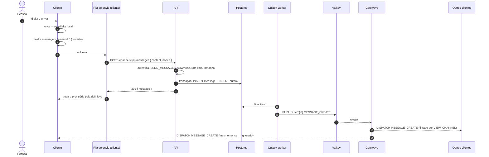
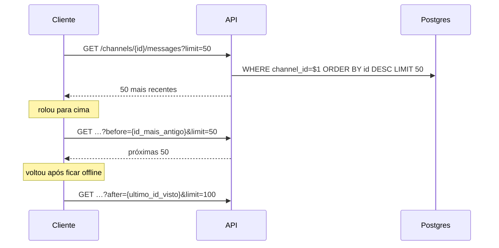
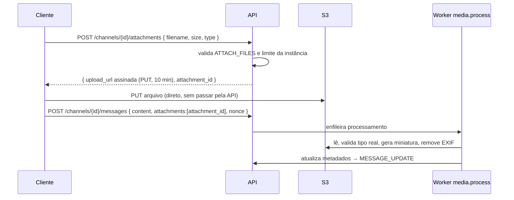

# 5. Chat

## 5.1 Princípios

1. **Envio por HTTPS, recebimento pelo gateway.** O envio tem resposta clara (sucesso, erro, limite), e o recebimento chega em tempo real.
2. **Atualização otimista.** A mensagem aparece na hora, marcada como "enviando".
3. **Idempotência por `nonce`.** O cliente gera um `nonce` único; reenvios com o mesmo `nonce` não criam duplicatas, e o evento recebido pelo gateway substitui a mensagem provisória.
4. **Ordem pelo `id` (Snowflake)**, atribuído no servidor.

## 5.2 Envio de mensagem

### Falhas

| Situação | Comportamento do cliente |
|---|---|
| Sem rede | Mantém na fila local e envia quando a conexão volta (mesmo `nonce`) |
| `429` | Espera `Retry-After` e reenvia |
| `4xx` de validação/permissão | Marca como "falhou" com motivo; opção de editar ou descartar |
| `5xx` / timeout | Até 3 tentativas com backoff exponencial; depois "falhou — tentar de novo" |
| Resposta perdida, mas gravou | O reenvio com o mesmo `nonce` devolve a mensagem já existente (`200`) |

A deduplicação no servidor usa um índice único parcial `(author_id, nonce)` com janela de 24 h (ou chave no Valkey com TTL).

## 5.3 Histórico e paginação

- A lista no cliente é **virtualizada** (renderiza só o que está visível).
- O cliente guarda em cache (IndexedDB) as últimas mensagens dos canais recentes para abrir instantaneamente.
- Pular para uma mensagem (resposta, link, busca) usa `?around={id}`.

## 5.4 Estado de leitura e menções

- Para cada `(user, channel)` guardamos `last_read_message_id` (Postgres, com escrita agregada a cada poucos segundos).
- Canal não lido = `channel.last_message_id > last_read_message_id`.
- Menções (`@pessoa`, `@cargo`, `@todos`) são extraídas no envio e geram contadores de menção e notificações push para quem está offline.

## 5.5 Edição, exclusão, reações, digitação

| Ação | Endpoint | Evento |
|---|---|---|
| Editar | `PATCH /channels/{c}/messages/{m}` (só autor) | `MESSAGE_UPDATE` com `edited_at` |
| Excluir | `DELETE …/{m}` (autor ou `MANAGE_MESSAGES`) | `MESSAGE_DELETE` — *soft delete*, conteúdo apagado de fato após a janela de auditoria |
| Reagir | `PUT …/{m}/reactions/{emoji}/@me` | `MESSAGE_REACTION_ADD` |
| Digitando | `POST /channels/{c}/typing` (no máximo 1 a cada 8 s) | `TYPING_START` (o cliente esconde após 10 s) |

## 5.6 Anexos

## 5.7 Busca

- **Fase 1:** busca de texto do próprio Postgres (`tsvector` com dicionário `portuguese` e `simple`), por servidor.
- **Fase 2:** Meilisearch opcional para instâncias grandes, alimentado pela fila `outbox`.
- Filtros: autor, canal, tem anexo, menciona, antes/depois de data.
- A busca **sempre** reaplica `VIEW_CHANNEL` e `READ_HISTORY` antes de devolver resultados.
