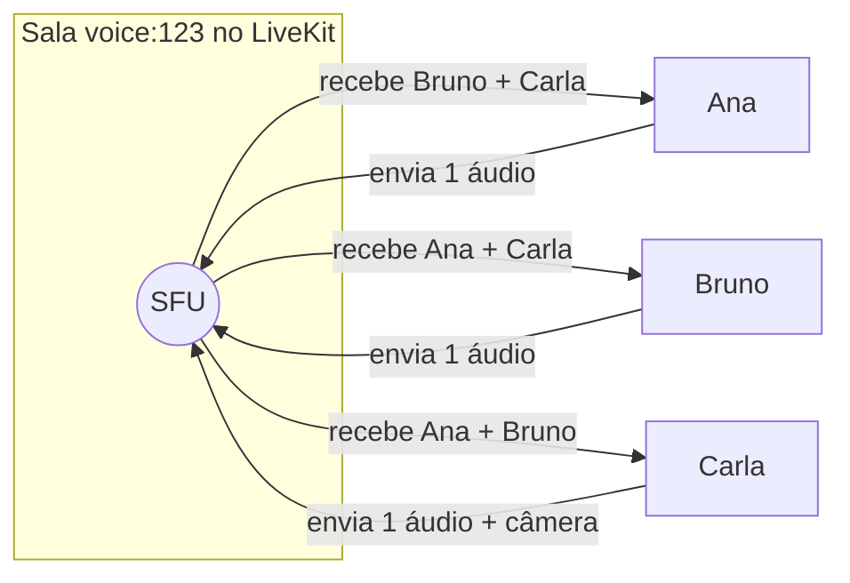
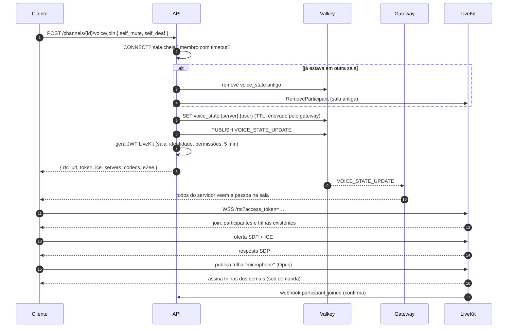
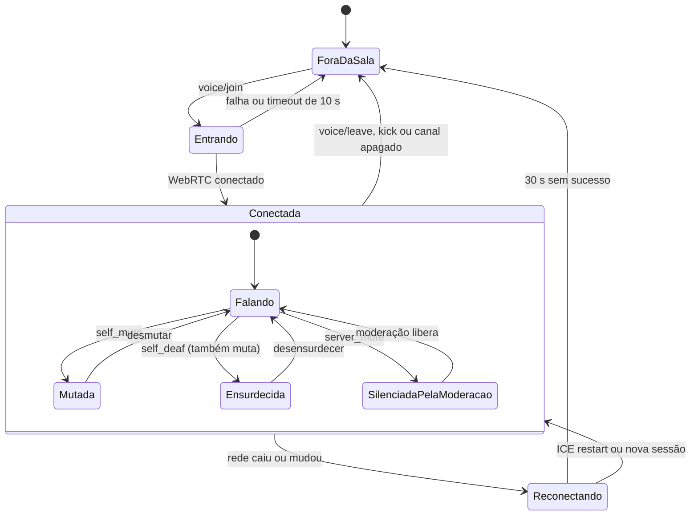
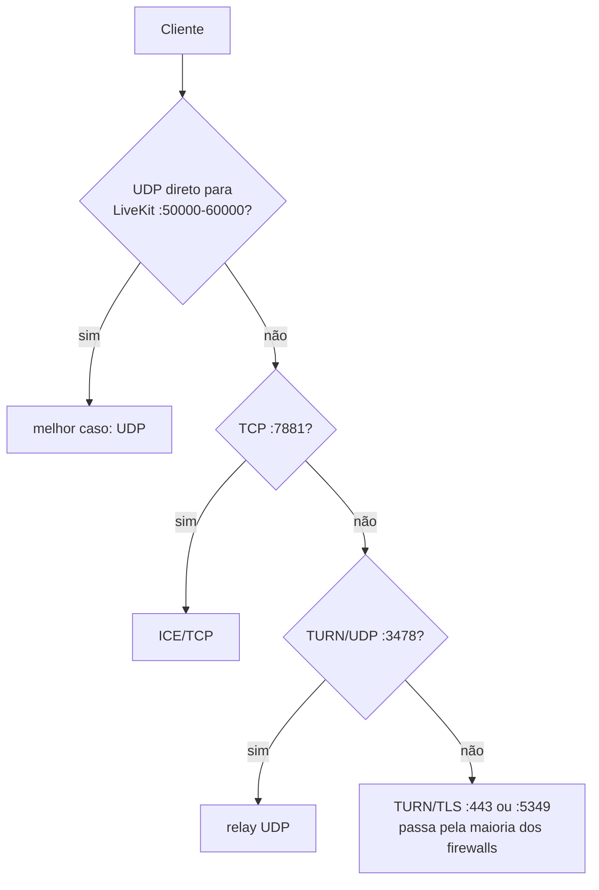

# 6. Voz

## 6.1 Modelo

- Um **canal de voz** é uma sala persistente: as pessoas entram e saem quando quiserem.
- Cada canal de voz corresponde a uma **sala LiveKit** chamada `voice:{channel_id}`.
- Topologia **SFU**: cada participante mantém **uma única** conexão WebRTC com o servidor de mídia, que repassa os fluxos aos demais. Não há conexões par a par (com 10 pessoas, P2P exigiria 9 uploads de cada uma).
- Quem está em qual sala (o **estado de voz**) é responsabilidade do backend do Voxa; o LiveKit cuida só da mídia.

## 6.2 Entrar numa sala

### Por que o estado de voz não vem só do LiveKit?

- A **lista de quem está na sala** aparece para todo o servidor, inclusive para quem não está conectado ao SFU.
- Mute/deaf, permissões e moderação (mover, desconectar) são regras do Voxa.
- Os webhooks do LiveKit (`participant_joined`, `participant_left`, `track_published`) servem de **confirmação e reconciliação**: se alguém fechou o app sem avisar, o webhook `participant_left` limpa o estado. Um job de reconciliação periódico compara as salas do LiveKit com o Valkey.

## 6.3 Estados de uma pessoa na sala

O LiveKit permite revogar a permissão de publicar em tempo real (`UpdateParticipant`), então `server_mute` é aplicado **no servidor** e não depende do cliente cooperar.

## 6.4 Áudio

| Item | Configuração |
|---|---|
| Codec | Opus, 48 kHz, mono para voz (estéreo opcional por sala) |
| Taxa | 64 kbit/s padrão; ajustável por canal (`bitrate`, 8–128 kbit/s); limite superior definido pela instância |
| DTX | Ligado (não envia pacotes no silêncio) |
| FEC in-band + RED | Ligados — tolera perda de pacotes em redes ruins |
| Processamento | `echoCancellation`, `noiseSuppression`, `autoGainControl` do navegador; supressão de ruído por IA opcional com **RNNoise** (BSD) em AudioWorklet/WASM |
| Detecção de fala | Pelo nível de áudio que o próprio LiveKit calcula (`ActiveSpeakers`) — indicador de "falando" sem processamento extra no cliente |
| Modo de entrada | Detecção de voz (limiar ajustável) ou "aperte para falar" (desktop com atalho global via Tauri) |

## 6.5 Vídeo (câmera)

- Codec padrão **VP8** (máxima compatibilidade); **H.264** quando há codificação por hardware; **AV1/VP9 SVC** opcionais quando todos os participantes suportam.
- **Simulcast** com 3 camadas (ex.: 180p, 360p, 720p). O SFU entrega a cada pessoa a camada adequada ao tamanho do quadro na tela e à banda disponível (*adaptive stream* + *dynacast*: camadas que ninguém assiste param de ser codificadas).
- Câmera desligada por padrão ao entrar.

## 6.6 Rede: NAT, firewall e TURN

O cliente recebe a lista de servidores ICE no `voice/join`, com credenciais TURN temporárias.

## 6.7 Qualidade e diagnóstico

- O cliente coleta `getStats()` a cada 2 s: RTT, perda, *jitter*, taxa enviada/recebida, codec.
- Um indicador de conexão (verde/amarelo/vermelho) aparece no painel de voz; ao clicar, mostra os números.
- Métricas **agregadas e anônimas** (histograma de RTT e perda por região, sem identificar pessoas) vão para o Prometheus via LiveKit, para orientar onde colocar novos nós.

## 6.8 Criptografia

| Camada | Proteção |
|---|---|
| Sinalização | TLS (WSS) |
| Mídia em trânsito | DTLS-SRTP (obrigatório no WebRTC) — protege contra quem está na rede, mas o SFU vê a mídia |
| **E2EE opcional por sala** | Criptografia de quadros com **Insertable Streams / RTCRtpScriptTransform** (suporte nativo do LiveKit): o SFU repassa sem conseguir decifrar |

Fases da E2EE:

1. **Fase 2 do roadmap:** chave por sala derivada de um segredo distribuído pela API aos membros autorizados. Protege contra o operador da mídia, mas **não** contra o operador da API.
2. **Fase 4:** troca de chaves com **MLS** (RFC 9420, implementação `openmls`): a chave muda quando alguém entra ou sai, o servidor nunca a conhece, e é possível verificar a identidade dos participantes. É o mesmo princípio usado por grandes plataformas em 2024–2026.

Detalhes no [modelo de ameaças](09-seguranca-e-privacidade.md).

## 6.9 Moderação em voz

| Ação | Permissão | Efeito |
|---|---|---|
| Silenciar no servidor | `MUTE_MEMBERS` | Revoga a publicação de áudio no LiveKit |
| Ensurdecer no servidor | `MUTE_MEMBERS` | Revoga a assinatura de trilhas |
| Mover para outra sala | `MOVE_MEMBERS` | Emite um novo token e envia o evento `VOICE_MOVE` |
| Desconectar | `MOVE_MEMBERS` | `RemoveParticipant` + limpa o estado |
| Limite de pessoas | `MANAGE_CHANNELS` | `user_limit` no canal |
| Fala prioritária | `PRIORITY_SPEAKER` | Os clientes reduzem o volume dos outros enquanto essa pessoa fala |
