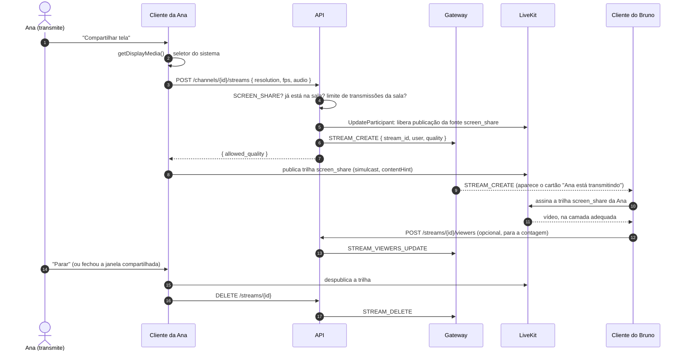
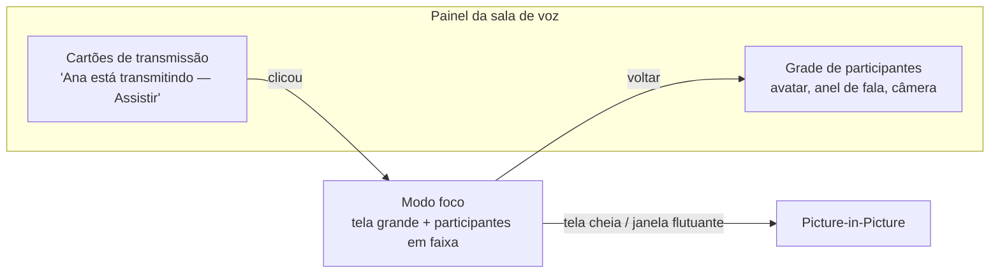

# 7. Compartilhamento de tela

## 7.1 Modelo

- Uma **transmissão** é a tela (ou janela, ou aba) de alguém publicada **dentro de um canal de voz**.
- Quem transmite precisa estar na sala e ter `SCREEN_SHARE`.
- Quem está na sala vê um cartão "Ana está transmitindo" e **escolhe** assistir. Ninguém recebe o vídeo da tela sem pedir, o que economiza muita banda.
- A transmissão usa a **mesma conexão WebRTC da voz**, como trilhas extras (`screen_share` e, opcionalmente, `screen_share_audio`). Não é preciso abrir uma segunda conexão.

> Outras plataformas abrem uma conexão de mídia separada por transmissão (ver [referência](referencia/estudo-discord.md)). Com o LiveKit, publicar trilhas de fontes diferentes na mesma sala atende ao mesmo objetivo com menos complexidade. Se no futuro for preciso isolar transmissões grandes em outro nó, a sala `stream:{channel}:{user}` pode ser criada sem mudar o protocolo do cliente.

## 7.2 Fluxo



O webhook `track_unpublished` do LiveKit também encerra a transmissão, caso o cliente caia sem avisar.

## 7.3 Captura

| Plataforma | Como captura |
|---|---|
| Navegador | `navigator.mediaDevices.getDisplayMedia()`; áudio da aba no Chrome/Edge |
| Desktop (Tauri) | Seletor próprio com miniaturas de telas e janelas. **Linux:** PipeWire via portal XDG (Wayland e X11). **Windows:** Windows Graphics Capture. **macOS:** ScreenCaptureKit. Áudio do sistema quando o SO permite. |
| Mobile (roadmap) | Android `MediaProjection`; iOS Broadcast Extension |

Restrições de captura:

```ts
// somente ilustrativo — packages/media/src/screen.ts
const stream = await navigator.mediaDevices.getDisplayMedia({
  video: { frameRate: { ideal: fps, max: fps } },
  audio: wantsAudio
    ? { echoCancellation: false, noiseSuppression: false, autoGainControl: false }
    : false,
});
```

O processamento de voz (eco, ruído, ganho) fica **desligado** no áudio da tela, porque ele destruiria música e áudio de jogos.

## 7.4 Codificação

| Ajuste | Conteúdo de "texto" (código, slides) | Conteúdo de "movimento" (vídeo, jogo) |
|---|---|---|
| `track.contentHint` | `"detail"` / `"text"` | `"motion"` |
| `degradationPreference` | `maintain-resolution` | `maintain-framerate` |
| FPS sugerido | 15–30 | 30–60 |
| Codec preferido | VP9 / AV1 (melhor para texto nítido), senão H.264 | H.264 por hardware, senão VP8 |

O cliente oferece um seletor **"Otimizar para: texto nítido / movimento fluido"**, que ajusta esses parâmetros.

**Simulcast da tela:** 2 camadas (ex.: completa + metade da resolução) para que espectadores com conexão fraca ou com a transmissão em miniatura recebam menos dados.

## 7.5 Qualidade — sem paywall

Os tetos vêm da **configuração da instância** (ver [Infraestrutura](03-infraestrutura.md#limites-configuráveis-pela-instância)), não de um plano pago. Qualquer pessoa escolhe até o teto da instância:

| Preset | Resolução | FPS | Taxa aproximada |
|---|---|---|---|
| Economia | 720p | 15 | 1–1,5 Mbit/s |
| **Padrão** | 1080p | 30 | 2,5–4 Mbit/s |
| Fluido | 1080p | 60 | 4–6 Mbit/s |
| Alta | 1440p | 60 | 6–8 Mbit/s |
| Original | resolução da fonte | 60 | até o teto de banda da instância |

Se a sala ficar pesada, o servidor pode **rebaixar automaticamente** novas transmissões (`allowed_quality` na resposta de `POST /streams`) e o cliente avisa: "A instância limitou a transmissão a 1080p30 neste momento".

## 7.6 Interface



- Vários espectadores podem **assistir lado a lado** (grade) quando há mais de uma transmissão.
- Controles para quem assiste: volume do áudio da transmissão, tela cheia, PiP, qualidade (automática/forçar menor).
- Controles para quem transmite: trocar a fonte sem encerrar (`replaceTrack`), pausar, mudar o preset, ver quantas pessoas assistem.
- Acessibilidade: anúncio por leitor de tela quando uma transmissão começa ou termina; todos os controles alcançáveis por teclado.
