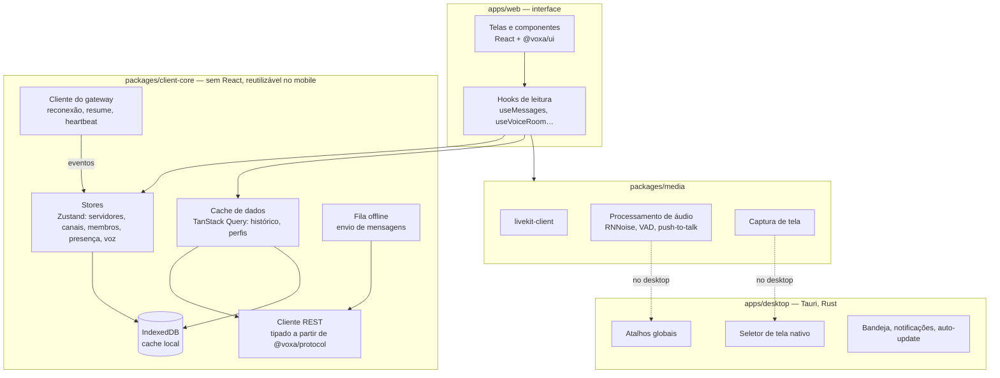
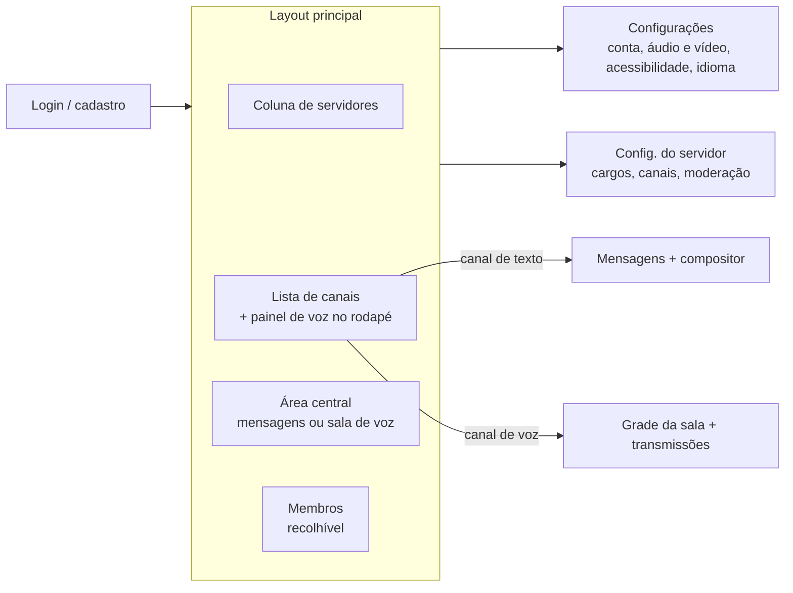

# 8. Aplicação cliente

## 8.1 Plataformas

| Plataforma | Tecnologia | Fase |
|---|---|---|
| **Web** | React 19 + Vite, SPA servida pelo Caddy | 1 |
| **Desktop** (Linux, Windows, macOS) | Tauri 2, que embala o mesmo app web e adiciona recursos nativos | 2 |
| **Mobile** (Android, iOS) | Proposta: React Native compartilhando `@voxa/client-core`; alternativa: Capacitor | 4 |

Por que Tauri em vez de Electron: binário de ~10 MB contra ~100 MB, menos memória e núcleo em Rust para captura de tela e atalhos globais. O WebView do sistema varia (WebKitGTK no Linux, WebView2 no Windows, WKWebView no macOS), por isso testamos WebRTC nos três ([ADR-0006](adr/0006-cliente-react-tauri.md)).

## 8.2 Camadas

### Fluxo de dados

- **Eventos do gateway** atualizam as stores (fonte da verdade do que está "ao vivo").
- **Consultas REST** (histórico, perfis) ficam no TanStack Query; eventos do gateway **atualizam esse cache** diretamente (ex.: `MESSAGE_CREATE` insere no topo da página atual), sem refazer requisições.
- Toda a tipagem (eventos, payloads, erros) vem de `@voxa/protocol`. Se o servidor mudar um campo, o cliente deixa de compilar.

## 8.3 Estrutura de telas

- **Painel de voz persistente:** ao navegar para um canal de texto, a pessoa continua na sala, e o rodapé mostra os controles (mudo, surdo, câmera, tela, sair).
- **Responsivo:** em telas estreitas, as colunas viram gavetas.

## 8.4 Design system (`@voxa/ui`)

- Componentes acessíveis sobre **Radix UI** (primitivos sem estilo, MIT), com tokens de design em CSS (cores, espaçamento, tipografia).
- Temas claro, escuro e alto contraste; respeita `prefers-reduced-motion`.
- Ícones: **Lucide** (ISC).
- Catálogo de componentes no **Storybook**, com testes de acessibilidade (axe).

## 8.5 Internacionalização

- `i18next` com arquivos de mensagens por idioma (`locales/pt-BR.json`, `en.json`, `es.json`…).
- **pt-BR é o idioma de referência**; as traduções são feitas pela comunidade (ex.: Weblate auto-hospedado).
- Datas e números com `Intl`; nada de texto fixo no código (regra de lint).

## 8.6 Acessibilidade

| Requisito | Como |
|---|---|
| Leitor de tela | Lista de mensagens com `role="log"` e `aria-live="polite"`; anúncios de entrada e saída em voz |
| Teclado | Atalhos documentados (`Ctrl+K` busca rápida, `Alt+↑/↓` troca de canal, `Ctrl+Shift+M` mudo); foco visível sempre |
| Contraste | WCAG 2.2 AA mínimo; tema de alto contraste |
| Movimento | Animações reduzidas quando o sistema pede; GIFs pausáveis |
| Voz | Indicador de fala também por forma (anel e ícone), não só por cor |

## 8.7 Notificações

- **Web:** Web Push (VAPID) via service worker.
- **Desktop:** notificações nativas pelo Tauri.
- **Android sem Google:** suporte a UnifiedPush (ex.: ntfy), coerente com o foco em software livre.
- Controles por servidor e por canal: tudo, só menções, nada; horário de silêncio.

## 8.8 Desempenho (metas)

| Métrica | Meta |
|---|---|
| Primeira carga do app web (3G rápido) | < 3 s até o login interativo |
| Bundle inicial (gzip) | < 250 kB; o código de voz é carregado sob demanda |
| Trocar de canal com cache | < 100 ms |
| Lista de 10 000 mensagens | Rolagem a 60 fps (virtualização) |
| Memória do desktop ocioso | < 200 MB |
