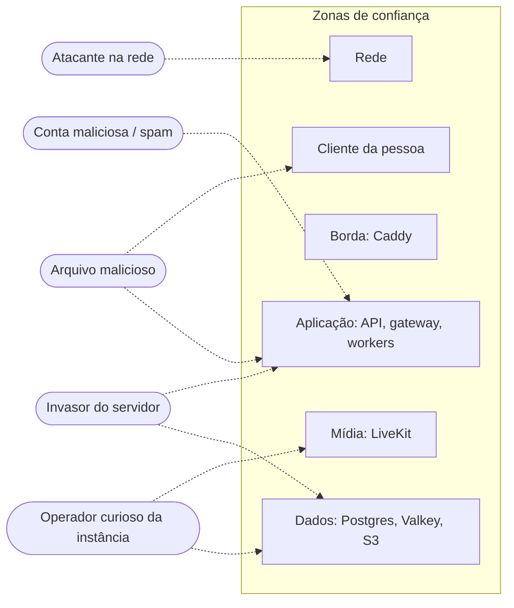
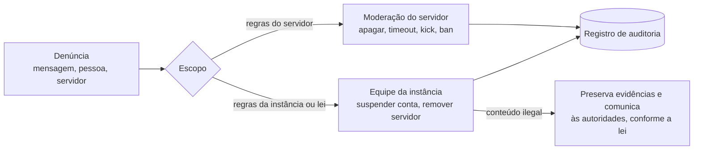

# 9. Segurança e privacidade

## 9.1 Princípios

1. **Coletar o mínimo.** Só guardamos o que é necessário para o serviço funcionar.
2. **Transparência.** O que é guardado, por quanto tempo e quem acessa está documentado aqui e na política de privacidade de cada instância.
3. **Controle da pessoa usuária.** Exportar e apagar os próprios dados é autosserviço.
4. **Defesa em profundidade.** Nenhuma camada depende só de outra.

## 9.2 Modelo de ameaças

| Ameaça | Mitigação |
|---|---|
| Escuta na rede | TLS 1.3 em tudo; HSTS; DTLS-SRTP na mídia |
| Roubo de token | Access token curto (15 min); refresh rotativo com detecção de reuso; tokens guardados como hash; cookies `HttpOnly`, `Secure`, `SameSite=Strict` no web |
| Força bruta / *credential stuffing* | Argon2id; limite por IP e por conta; verificação contra senhas vazadas (k-anonymity, opcional) |
| XSS | Markdown renderizado para árvore React (nunca `innerHTML`); CSP estrita; links com `rel="noopener noreferrer"` |
| CSRF | API só aceita `Authorization: Bearer` ou cookie com `SameSite=Strict` + cabeçalho anti-CSRF |
| SSRF em prévias de links | Busca de prévia feita por worker isolado, que bloqueia IPs privados e segue no máximo 3 redirecionamentos |
| Upload malicioso | Validação do tipo real (*magic bytes*); servido de domínio separado (`cdn.`) com `Content-Disposition` e `X-Content-Type-Options: nosniff`; ClamAV opcional |
| Escalada de permissão | Cálculo de permissões centralizado e com testes de propriedade; hierarquia de cargos (não se edita cargo acima do seu) |
| Spam e raids | Rate limit; verificação de e-mail; níveis de verificação por servidor; captcha auto-hospedado (ex.: mCaptcha, ALTCHA) quando necessário |
| Operador da instância lendo chamadas | **E2EE por sala** — o SFU repassa sem decifrar (ver [Voz](06-voz.md#68-criptografia)) |
| Invasor com acesso ao banco | Senhas e tokens em hash; segredos fora do banco; backups cifrados (`age`) |
| Dependência comprometida | Lockfile; `pnpm audit` e Dependabot/Renovate; imagens com SBOM e assinatura (cosign); builds reprodutíveis |

## 9.3 O que cada parte do sistema pode ver

| Dado | Operador da instância | Outras pessoas | Terceiros |
|---|---|---|---|
| Mensagens em canais de servidor | Sim (estão no banco) | Quem tem `VIEW_CHANNEL` | Não |
| DMs | Sim (fase 1); **não** com DMs E2EE (roadmap) | Participantes | Não |
| Áudio/vídeo sem E2EE | Tecnicamente possível no SFU (não é gravado) | Participantes | Não |
| Áudio/vídeo **com E2EE** | **Não** | Participantes | Não |
| E-mail, IP de login | Sim (IP guardado por 30 dias para segurança) | Não | Não |
| Presença | Sim | Conforme privacidade (ex.: invisível) | Não |

Isso deve ser explicado em linguagem simples na página "Privacidade" do app.

## 9.4 LGPD e GDPR

Cada instância é **controladora** dos dados das pessoas que a usam. O projeto fornece as ferramentas:

| Direito | Implementação |
|---|---|
| Acesso e portabilidade | `Configurações → Privacidade → Exportar meus dados`: ZIP com JSON (perfil, mensagens, servidores) e anexos |
| Eliminação | Excluir conta: anonimiza o autor das mensagens (`Usuário removido`), apaga perfil, anexos próprios e sessões. Opção de também apagar todas as mensagens |
| Correção | Edição de perfil e mensagens |
| Informação | Página `/privacy` gerada a partir de um modelo, editável pelo admin |
| Base legal | Execução de contrato (conta); legítimo interesse (segurança, IP de login) |
| Encarregado (DPO) | Campo de contato configurável na instância |

**Retenção padrão** (configurável): logs 14 dias; IP de login 30 dias; mensagens apagadas removidas de fato após 30 dias; contas inativas não são apagadas automaticamente.

**Proteção de crianças e adolescentes:** idade mínima configurável por instância (padrão 13 anos, ou o que a lei local exigir); denúncias priorizadas; sem perfis públicos indexáveis por padrão.

## 9.5 Moderação

- Registro de auditoria imutável por servidor (quem fez o quê, quando).
- Filtros automáticos opcionais por servidor: palavras, links, menções em massa.
- Ferramentas de moderação também precisam de acessibilidade e atalhos.

## 9.6 Divulgação de vulnerabilidades

- Arquivo `SECURITY.md` com e-mail dedicado e chave PGP.
- Prazo de resposta: 72 h para confirmar o recebimento; correção crítica em até 14 dias; divulgação coordenada.
- Crédito público a quem reportar (se quiser).
