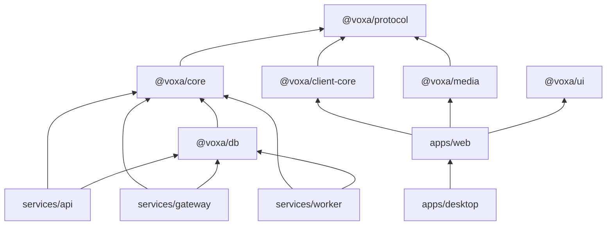
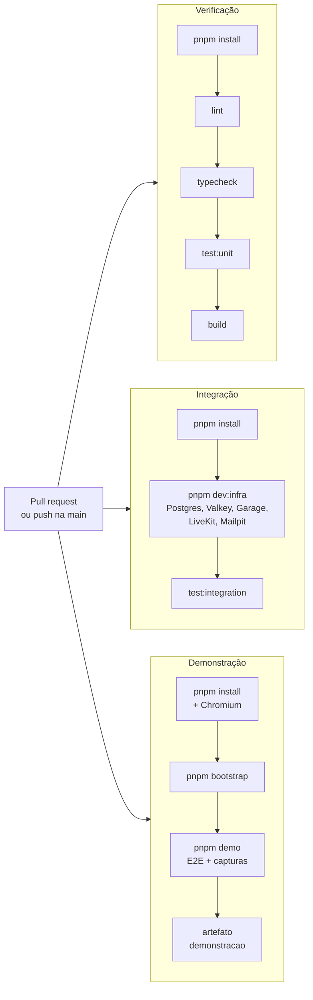
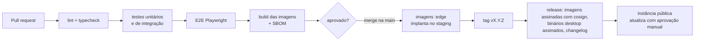

# 10. Desenvolvimento

## 10.1 Estrutura do repositório (monorepo)

```
voxa/
├── apps/
│   ├── web/                 # app React (Vite)
│   └── desktop/             # Tauri 2 (src-tauri em Rust + reaproveita apps/web)
├── services/
│   ├── api/                 # Fastify — REST
│   ├── gateway/             # WebSocket
│   └── worker/              # filas
├── packages/
│   ├── protocol/            # esquemas Zod, tipos, OpenAPI, eventos do gateway
│   ├── core/                # domínio do backend: serviços, permissões, snowflake
│   ├── db/                  # Drizzle: esquema e migrações
│   ├── client-core/         # stores, cliente REST/gateway, fila offline (sem React)
│   ├── media/               # wrapper do livekit-client, áudio, captura de tela
│   ├── ui/                  # design system
│   └── config/              # tsconfig, eslint, prettier compartilhados
├── infra/
│   ├── compose/             # docker-compose.yml, Caddyfile, livekit.yaml, .env.example
│   ├── helm/                # chart para Kubernetes
│   └── grafana/             # dashboards versionados
├── docs/                    # esta documentação
└── .github/workflows/       # CI/CD
```

Ferramentas: **pnpm** (workspaces), **Turborepo** (cache de build e testes), **TypeScript 7** estrito e **Biome** (lint e formatação).

### Configuração compartilhada (`packages/config`)

Cada pacote estende uma das variantes:

| Variante | Para | Resolução de módulos |
|---|---|---|
| `tsconfig.node.json` | `services/*` | `nodenext`, com `rewriteRelativeImportExtensions` (importe `./arquivo.ts`; o build emite `./arquivo.js`) |
| `tsconfig.library.json` | `packages/*` consumidos pelo Node e pelo web | Igual à Node, gerando também `.d.ts` |
| `tsconfig.react.json` | `apps/web` | `bundler` (o Vite resolve), com DOM e JSX |

Todas herdam de `tsconfig.base.json`: `strict`, `noUncheckedIndexedAccess`, `verbatimModuleSyntax` e `isolatedModules`.

- **TypeScript 7** (o compilador reescrito em Go) **não tem a API JavaScript clássica**. Ferramentas que dependem dela (`typescript-eslint`, `tsup`/`rollup-plugin-dts` para `.d.ts`, `vite-plugin-dts`) não funcionam. Use o próprio `tsc` para gerar tipos; Vite, Vitest e `tsx` só removem os tipos e funcionam normalmente.
- No TS 7, `types` é `[]` por padrão: declare explicitamente o que cada variante usa (`node`, `vite/client`).
- O **Biome** roda uma vez na raiz (`pnpm lint`, `pnpm lint:fix`, `pnpm format`). O `pnpm typecheck` roda o `tsc --noEmit` de cada pacote via Turborepo.
- As **fronteiras da regra abaixo** são verificadas pelo Biome (`noRestrictedImports` em `biome.json`): `apps/*`, `client-core`, `media` e `ui` não importam `@voxa/core`/`@voxa/db`, e o backend não importa `@voxa/ui`/`@voxa/media`.

### Dependências entre pacotes



Regra: o código de cliente **nunca** importa `core` ou `db`; o backend nunca importa `ui` ou `media`. O lint (Biome) garante isso.

## 10.2 Ambiente local

**Pré-requisitos:**
- **Node.js 24 LTS**: veja o `.nvmrc`; com nvm, `nvm install && nvm use`.
- **pnpm 12**: `corepack enable` (o pnpm troca sozinho para a versão do `packageManager`).
- **Docker** com Compose v2.
- **Rust stable**: só para o app desktop (Fase 2).

```bash
git clone https://github.com/devballao/voxa.git && cd voxa
pnpm install
pnpm bootstrap   # só na primeira vez
pnpm dev         # todo dia
```

Abra **http://localhost:5173**: a página "Status do ambiente" deve mostrar **✓ Tudo funcionando**.

| Comando | O que faz |
|---|---|
| `pnpm bootstrap` | Confere Node e Docker, cria o `.env` a partir do `.env.example` (se não existir), sobe a infraestrutura e aplica as migrações. Pode ser repetido sem problema |
| `pnpm dev` | Confere `.env`, portas e infraestrutura, e **sobe a infraestrutura sozinho** se ela estiver parada (por exemplo, depois de reiniciar o computador). Então roda, com hot reload: **API** (`:3000`), **gateway** (`:4000`), **worker**, **app web** (`:5173`) e o *watch* de `@voxa/protocol` e `@voxa/db`. Cada linha da saída vem com o nome do serviço. **Ctrl+C** encerra tudo de forma limpa |
| `pnpm dev:infra:down` | Para a infraestrutura (mantém os dados) |
| `pnpm dev:infra:reset` | Para a infraestrutura e apaga os dados |

> O nome é `bootstrap` porque `pnpm setup` é um comando nativo do pnpm (configura o próprio pnpm).

**Tempo medido** (2026-10-16), do `git clone` até a página verde, sem imagens Docker nem cache do pnpm, num GitHub Codespace de 2 vCPU: **51 s**.

| Etapa | Tempo |
|---|---|
| `pnpm install` (251 pacotes, 339 MB) | 4 s |
| `pnpm bootstrap` (inclui baixar as 5 imagens Docker) | 35 s |
| `pnpm dev` até a página verde | 12 s |

Esse número vale para a rede de um datacenter. Numa conexão doméstica, os downloads (pacotes e imagens) devem levar alguns minutos. A meta é ficar abaixo de 10 minutos.

**Problemas comuns.** Os scripts explicam o que fazer em cada caso:

| Mensagem | Solução |
|---|---|
| `Node X não atende a ">=24.11.0 <25"` | `nvm install && nvm use` (ou fnm, volta, asdf) |
| `Docker não encontrado` / `não está respondendo` | Instale ou inicie o Docker |
| `Arquivo .env não encontrado` | `pnpm bootstrap` |
| `Portas já em uso` | Outro `pnpm dev` aberto, ou um Postgres/Redis local. Veja [infra/compose/README.md](../infra/compose/README.md#porta-ocupada-address-already-in-use) |

- Portas, credenciais de dev e mais soluções de problemas da infraestrutura: [`infra/compose/README.md`](../infra/compose/README.md).
- E-mails de desenvolvimento aparecem no **Mailpit** (`http://localhost:8025`).

### Dev Container (GitHub Codespaces ou VS Code)

O repositório tem um [`.devcontainer/devcontainer.json`](../.devcontainer/devcontainer.json) que prepara tudo sozinho: Ubuntu 24.04, Node 24 e pnpm (via corepack), Docker dentro do contêiner, o Claude Code (CLI e extensão) e as extensões recomendadas.

- **Codespaces:** botão **Abrir no GitHub Codespaces** no README, ou *Code → Codespaces → Create codespace on main*.
- **VS Code local:** com a extensão *Dev Containers*, rode *Dev Containers: Reopen in Container*.

Ao criar o contêiner, rodam `pnpm install` e `pnpm bootstrap`. Quando terminar, é só:

```bash
pnpm dev
```

A porta **5173** (app web) é anunciada com uma notificação. As demais (API 3000, gateway 4000, LiveKit 7880, Mailpit 8025, S3 3900) ficam na aba *Ports*, com rótulos. O Vite já aceita o domínio `*.app.github.dev`.

**Limites do Codespaces para mídia:** o Codespaces encaminha só portas **TCP**. A mídia de voz e vídeo (UDP, porta `7882`) não chega de fora. Testes entre abas do mesmo navegador devem funcionar via ICE/TCP (porta `7881`), o que ainda será validado quando houver cliente de voz, no MVP. Para testes com vários dispositivos, rode o ambiente localmente. Detalhes em [infra/compose/README.md](../infra/compose/README.md#voz-e-vídeo-no-github-codespaces).

**Claude Code no Codespace:** o histórico das conversas fica em `~/.claude`, fora de `/workspaces`, e se perde quando o Codespace é recriado ou excluído. Para manter as conversas na sua conta (visíveis no app do Claude e em claude.ai/code), rode na pasta do projeto `claude remote-control --name "voxa codespace"` e deixe o terminal aberto. O [`CLAUDE.md`](../CLAUDE.md) da raiz dá a qualquer sessão nova o contexto e as convenções do projeto.

## 10.3 Testes

| Tipo | Ferramenta | O que cobre |
|---|---|---|
| Unitário | Vitest | Permissões, snowflake, validação, reducers das stores |
| Propriedades | fast-check | Cálculo de permissões (ex.: "deny sempre vence allow no mesmo nível") |
| Integração | Vitest + Testcontainers | API contra Postgres/Valkey reais; gateway com clientes WebSocket simulados |
| Contrato | Esquemas de `@voxa/protocol` | Respostas da API batem com o OpenAPI |
| E2E | Playwright | Cadastro → criar servidor → mensagem → entrar em voz (Chromium e Firefox, com mídia simulada `--use-fake-device-for-media-stream`) |
| Carga | k6 (HTTP/WS) + `lk load-test` (mídia) | Mensagens por segundo, conexões no gateway, participantes por nó |
| Acessibilidade | axe (Storybook + Playwright) | Componentes e telas principais |

Meta de cobertura: 80 % em `packages/core` e `packages/protocol`. Nas demais partes, testes guiados por risco.

### Como rodar e adicionar testes

**Onde ficam os testes:**

| Tipo | Local | Precisa de |
|---|---|---|
| **Unitário** | Ao lado do código: `src/**/*.test.ts` (ex.: `app.ts` + `app.test.ts`) | Nada (sem Docker, sem `.env`) |
| **Integração** | Pasta própria em cada pacote: `test/integration/**/*.test.ts` | `pnpm dev:infra` + `.env` |

Unitários ficam junto do código, como é o padrão no ecossistema TypeScript/Vitest: fica evidente quando um arquivo não tem teste, e o teste se move junto com o módulo. Os de integração ficam separados porque são mais lentos e dependem de serviços externos. Tudo fica no mesmo repositório, para código e teste mudarem no mesmo PR.

| Comando (na raiz) | O que faz |
|---|---|
| `pnpm test:unit` | Só os unitários. Rápido, funciona sem Docker; use no dia a dia |
| `pnpm test:integration` | Só os de integração. **Falha** se a infraestrutura não estiver configurada, para o CI não passar sem testar nada. Sem cache |
| `pnpm test` | Todos. Os de integração são **pulados** se não houver `.env` |
| `pnpm test:watch` | Modo watch em todos os pacotes |
| `pnpm test:coverage` | Todos, com cobertura (v8) de `src/`; relatório HTML e lcov em `<pacote>/coverage/` |
| `pnpm --filter @voxa/<pacote> test:unit` | Só um pacote |

Cada pacote tem seu próprio Vitest, estendendo a configuração compartilhada (`@voxa/config/vitest`). Não usamos o recurso de *projects*/*workspace* do Vitest: ele impediria o cache por pacote do Turborepo. Para adicionar testes a um pacote:

1. `devDependencies`: `vitest`, `@vitest/coverage-v8` e `vite` (mesmas versões de `packages/config`).
2. Scripts:
   ```json
   "test": "vitest run",
   "test:unit": "vitest run src/",
   "test:integration": "vitest run --mode integration test/integration/",
   "test:watch": "vitest",
   "test:coverage": "vitest run --coverage"
   ```
   Pacotes sem testes de integração usam `"test:unit": "vitest run"` e não têm `test:integration`.
3. `vitest.config.ts`:
   ```ts
   import { configVitestVoxa } from "@voxa/config/vitest";

   export default configVitestVoxa(); // ou configVitestVoxa({ test: { /* ajustes */ } })
   ```
4. Nos testes de integração, decida entre rodar, pular ou falhar com `integracaoDisponivel`:
   ```ts
   import { integracaoDisponivel } from "@voxa/config/vitest";

   const rodar = integracaoDisponivel(urlDoBanco !== undefined, "Rode `pnpm dev:infra` e `cp .env.example .env`.");
   describe.skipIf(!rodar)("integração com …", () => { /* … */ });
   ```
   Em `pnpm test`, sem infraestrutura, o bloco é pulado; em `pnpm test:integration` (modo `integration`), vira erro com a instrução.

### Testes de ponta a ponta e demonstração da etapa

Os testes de ponta a ponta (E2E) usam o **Playwright** e ficam em `apps/web/e2e/*.e2e.ts`. Eles abrem o app num Chromium de verdade, com o ambiente inteiro no ar.

| Comando | O que faz |
|---|---|
| `pnpm demo` | Sobe o ambiente (ou reaproveita um `pnpm dev` já rodando), roda os cenários E2E tirando capturas de tela e gera a **página de resumo** da etapa atual em `demo/milestone-<N>/index.html` |
| `pnpm demo --milestone 2` | O mesmo, para um milestone específico (número do GitHub) |
| `pnpm --filter @voxa/web test:e2e` | Só os testes E2E, sem capturas. Precisa do `pnpm dev` rodando |

A página de resumo é um arquivo só (as imagens vão embutidas): abra no navegador ou envie para alguém. Ela traz as capturas de cada cenário, as issues e os PRs que entraram na etapa e o que ficou para depois, consultados no GitHub. Sem acesso ao GitHub, a página sai só com as capturas.

Na primeira vez, o `pnpm demo` baixa o Chromium do Playwright (~150 MB). Se faltarem bibliotecas do sistema no Linux: `pnpm --filter @voxa/web exec playwright install --with-deps chromium`.

**Para acrescentar um cenário** à demonstração, escreva o teste E2E normalmente e chame `capturar` no ponto que vale mostrar:

```ts
import { expect, test } from "@playwright/test";
import { capturar } from "./demonstracao.ts";

test("cadastro com código por e-mail", async ({ page }) => {
  // …passos e verificações…
  await capturar(page, {
    id: "cadastro-codigo",                 // nome do arquivo .png
    titulo: "Cadastro: código enviado",
    descricao: "Depois de informar o e-mail, a pessoa recebe um código de 6 dígitos.",
  });
});
```

Fora do `pnpm demo`, `capturar` não faz nada. As capturas aparecem na página na ordem em que os cenários rodam (ordem alfabética dos arquivos).

## 10.4 Convenções

- **Commits:** [Conventional Commits](https://www.conventionalcommits.org/pt-br/) (`feat(gateway): resume em outro nó`), que alimentam o changelog automático.
- **Branches:** `main` sempre implantável; trabalho em `feat/…`, `fix/…`; PRs pequenos.
- **Revisão:** 1 aprovação; 2 para `packages/core/permissions`, autenticação e criptografia.
- **ADRs:** decisões de arquitetura novas ou alteradas viram um arquivo em `docs/adr/`.
- **Código:** sem `any` implícito; erros de domínio tipados (`VoxaError` com `code`); logs estruturados, nunca com conteúdo de mensagens.
- **Migrações:** sempre compatíveis com a versão anterior (expandir → migrar → contrair).

## 10.5 CI/CD

### O que roda hoje

O workflow [`.github/workflows/ci.yml`](../.github/workflows/ci.yml) roda em todo pull request e em todo push na `main`, com três jobs em paralelo:



- **Verificação:** com cache do pnpm e do Turborepo; não precisa de Docker.
- **Integração:** usa a **mesma infraestrutura do desenvolvimento local** (`pnpm dev:infra`). Assim o CI também testa o Compose e o script de inicialização. Se falhar, os logs dos contêineres aparecem no fim do job.
- **Demonstração:** roda os testes E2E com o ambiente completo e anexa a página de resumo da etapa ao workflow (artefato `demonstracao`, guardado por 30 dias). Para ver: aba *Actions* → a execução do PR → *Artifacts*.
- **Segurança:**
  - permissão mínima (`contents: read`; a demonstração também lê issues e PRs, para a página de resumo);
  - Actions fixadas pelo **hash do commit**, com a versão no comentário;
  - `persist-credentials: false` no checkout.
- **Concorrência:** um push novo no mesmo PR cancela a execução anterior.
- **Atualizar uma Action:** troque o hash e o comentário juntos, usando uma versão publicada há pelo menos 14 dias. Valide com `docker run --rm -v "$PWD:/repo" -w /repo rhysd/actionlint:1.7.12`.

### Visão completa (fases seguintes)



- Imagens publicadas no GitHub Container Registry (`ghcr.io/devballao/voxa-api` …).
- Binários do desktop: AppImage, `.deb`, Flatpak (Flathub); Windows `.msi`; macOS `.dmg`, com auto-update do Tauri apontando para releases assinados.
- Versionamento semântico; o protocolo do gateway tem versão própria (`?v=1`), e o servidor aceita a versão atual e a anterior.

## 10.6 Documentar enquanto desenvolve

- Cada PR que muda um fluxo atualiza o diagrama correspondente em `docs/`.
- A especificação OpenAPI é gerada no build e publicada em `/api/docs` (Scalar ou Redoc).
- Os eventos do gateway são documentados a partir dos esquemas de `@voxa/protocol` (geração automática).
