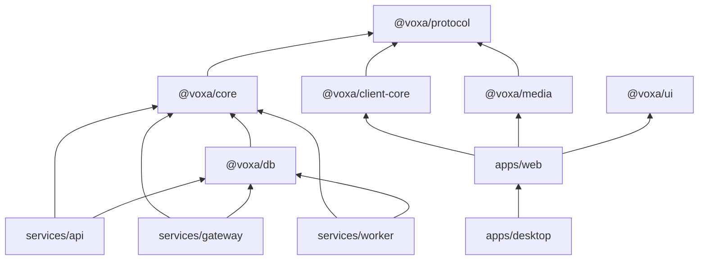
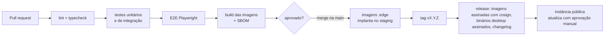

# 10. Desenvolvimento

## 10.1 Estrutura do repositório (monorepo)

```
voxa/
├── apps/
│   ├── web/                 # app React (Vite)
│   └── desktop/             # Tauri 2 (src-tauri em Rust + reaproveita apps/web)
├── services/
│   ├── api/                 # Fastify — REST
│   ├── gateway/             # WebSocket
│   └── worker/              # filas
├── packages/
│   ├── protocol/            # esquemas Zod, tipos, OpenAPI, eventos do gateway
│   ├── core/                # domínio do backend: serviços, permissões, snowflake
│   ├── db/                  # Drizzle: esquema e migrações
│   ├── client-core/         # stores, cliente REST/gateway, fila offline (sem React)
│   ├── media/               # wrapper do livekit-client, áudio, captura de tela
│   ├── ui/                  # design system
│   └── config/              # tsconfig, eslint, prettier compartilhados
├── infra/
│   ├── compose/             # docker-compose.yml, Caddyfile, livekit.yaml, .env.example
│   ├── helm/                # chart para Kubernetes
│   └── grafana/             # dashboards versionados
├── docs/                    # esta documentação
└── .github/workflows/       # CI/CD
```

Ferramentas: **pnpm** (workspaces), **Turborepo** (cache de build e testes), **TypeScript** estrito, **Biome** ou ESLint + Prettier.

### Dependências entre pacotes



Regra: o código de cliente **nunca** importa `core` ou `db`; o backend nunca importa `ui`. Uma verificação no CI garante isso.

## 10.2 Ambiente local

Pré-requisitos: Node.js 24 LTS (ver `.nvmrc`), pnpm 12 (via `corepack enable`), Docker; Rust stable só para o desktop.

```bash
git clone https://github.com/devballao/voxa.git && cd voxa
pnpm install
pnpm dev:infra        # sobe postgres, valkey, s3, livekit (modo dev) e mailpit via compose
pnpm db:migrate
pnpm db:seed          # servidor de exemplo + 3 contas de teste
pnpm dev              # api :3000, gateway :4000, web :5173 com hot reload
```

- E-mails de desenvolvimento aparecem no **Mailpit** (`http://localhost:8025`).
- Para testar voz com duas pessoas: abra uma janela anônima e entre com outra conta de teste.
- Também há um `devcontainer.json` para Codespaces e VS Code.

## 10.3 Testes

| Tipo | Ferramenta | O que cobre |
|---|---|---|
| Unitário | Vitest | Permissões, snowflake, validação, reducers das stores |
| Propriedades | fast-check | Cálculo de permissões (ex.: "deny sempre vence allow no mesmo nível") |
| Integração | Vitest + Testcontainers | API contra Postgres/Valkey reais; gateway com clientes WebSocket simulados |
| Contrato | Esquemas de `@voxa/protocol` | Respostas da API batem com o OpenAPI |
| E2E | Playwright | Cadastro → criar servidor → mensagem → entrar em voz (Chromium e Firefox, com mídia simulada `--use-fake-device-for-media-stream`) |
| Carga | k6 (HTTP/WS) + `lk load-test` (mídia) | Mensagens por segundo, conexões no gateway, participantes por nó |
| Acessibilidade | axe (Storybook + Playwright) | Componentes e telas principais |

Meta de cobertura: 80 % em `packages/core` e `packages/protocol`. Nas demais partes, testes guiados por risco.

## 10.4 Convenções

- **Commits:** [Conventional Commits](https://www.conventionalcommits.org/pt-br/) (`feat(gateway): resume em outro nó`), que alimentam o changelog automático.
- **Branches:** `main` sempre implantável; trabalho em `feat/…`, `fix/…`; PRs pequenos.
- **Revisão:** 1 aprovação; 2 para `packages/core/permissions`, autenticação e criptografia.
- **ADRs:** decisões de arquitetura novas ou alteradas viram um arquivo em `docs/adr/`.
- **Código:** sem `any` implícito; erros de domínio tipados (`VoxaError` com `code`); logs estruturados, nunca com conteúdo de mensagens.
- **Migrações:** sempre compatíveis com a versão anterior (expandir → migrar → contrair).

## 10.5 CI/CD



- Imagens publicadas no GitHub Container Registry (`ghcr.io/devballao/voxa-api` …).
- Binários do desktop: AppImage, `.deb`, Flatpak (Flathub); Windows `.msi`; macOS `.dmg`, com auto-update do Tauri apontando para releases assinados.
- Versionamento semântico; o protocolo do gateway tem versão própria (`?v=1`), e o servidor aceita a versão atual e a anterior.

## 10.6 Documentar enquanto desenvolve

- Cada PR que muda um fluxo atualiza o diagrama correspondente em `docs/`.
- A especificação OpenAPI é gerada no build e publicada em `/api/docs` (Scalar ou Redoc).
- Os eventos do gateway são documentados a partir dos esquemas de `@voxa/protocol` (geração automática).
