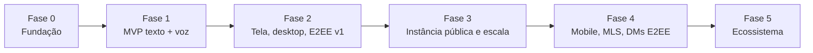

# 11. Roadmap

As fases são marcos de funcionalidade, não datas. A ordem pode mudar conforme a comunidade discutir nas issues.

## Fase 0 — Fundação

- [ ] Escolher a licença ([ADR-0001](adr/0001-licenca.md)) e criar `LICENSE`, `CODE_OF_CONDUCT.md`, `SECURITY.md`
- [ ] Monorepo com pnpm + Turborepo, lint e typecheck no CI
- [ ] `infra/compose` para desenvolvimento (Postgres, Valkey, S3, LiveKit, Mailpit)
- [ ] `@voxa/protocol` com os primeiros esquemas
- [ ] Snowflake, migrações iniciais, `/health`

**Pronto quando:** `pnpm dev` sobe tudo e o CI está verde.

## Fase 1 — MVP: texto e voz

- [ ] Cadastro, login, verificação de e-mail, sessões
- [ ] Servidores, canais de texto e voz, convites
- [ ] Cargos e permissões (bitfield + sobrescritas)
- [ ] Mensagens: enviar, editar, apagar, responder, menções, reações
- [ ] Anexos com upload assinado e miniaturas
- [ ] Gateway: HELLO/IDENTIFY/READY, heartbeat, RESUME, distribuição via Valkey
- [ ] Presença e "digitando"
- [ ] Voz com LiveKit: entrar, sair, mudo, surdo, indicador de fala
- [ ] App web responsivo, pt-BR e en
- [ ] Docker Compose de produção para nó único

**Pronto quando:** um grupo de 20 pessoas usa por uma semana sem bloqueios.

## Fase 2 — Tela, desktop e E2EE v1

- [ ] Compartilhamento de tela com presets e áudio da aba
- [ ] Câmera com simulcast
- [ ] App desktop (Tauri): seletor nativo de tela, atalho global para push-to-talk, bandeja
- [ ] E2EE opcional por sala (chave por sala)
- [ ] Supressão de ruído (RNNoise)
- [ ] Moderação: timeout, kick, ban, registro de auditoria, denúncias
- [ ] Notificações push (Web Push e UnifiedPush)
- [ ] Busca no Postgres

## Fase 3 — Instância pública e escala

- [ ] Observabilidade completa (dashboards e alertas)
- [ ] Testes de carga e tabela de dimensionamento validada
- [ ] Helm chart; múltiplos nós LiveKit; réplicas de leitura
- [ ] Exportar e excluir dados (LGPD)
- [ ] Instância pública operada pelo projeto, com página de transparência (custos, doações, incidentes)
- [ ] Documentação de auto-hospedagem testada por quem não é do núcleo do projeto

## Fase 4 — Mobile e criptografia avançada

- [ ] App Android e iOS
- [ ] E2EE das chamadas com MLS (troca de chaves sem o servidor conhecê-las) e verificação de identidade
- [ ] DMs com E2EE
- [ ] Passkeys (WebAuthn)

## Fase 5 — Ecossistema

- [ ] API pública estável e bots
- [ ] Ponte com o Matrix (avaliar federação)
- [ ] Legendas ao vivo locais (Whisper no cliente, opt-in)
- [ ] Gravação de chamadas opt-in, com consentimento explícito
- [ ] Palco/auditório (poucos falando, muitos ouvindo)

## Como propor mudanças

Abra uma issue com o rótulo `proposta`. Mudanças de arquitetura viram um ADR em `docs/adr/`.
