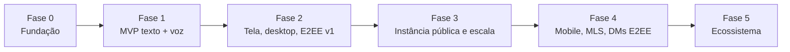
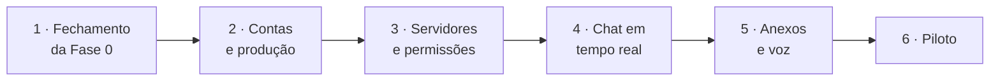

# 11. Roadmap

As fases são marcos de funcionalidade, não datas. A ordem pode mudar conforme a comunidade discutir nas issues.

## Fase 0 — Fundação

- [x] Escolher a licença ([ADR-0001](adr/0001-licenca.md)) e criar `LICENSE`, `CODE_OF_CONDUCT.md`, `SECURITY.md` ([#31](https://github.com/devballao/voxa/issues/31))
- [x] Monorepo com pnpm + Turborepo, lint e typecheck no CI ([#2](https://github.com/devballao/voxa/issues/2), [#3](https://github.com/devballao/voxa/issues/3), [#4](https://github.com/devballao/voxa/issues/4), [#12](https://github.com/devballao/voxa/issues/12), [#21](https://github.com/devballao/voxa/issues/21))
- [x] `infra/compose` para desenvolvimento (Postgres, Valkey, S3, LiveKit, Mailpit) ([#5](https://github.com/devballao/voxa/issues/5))
- [x] `@voxa/protocol` com os primeiros esquemas ([#6](https://github.com/devballao/voxa/issues/6))
- [x] Snowflake ([#34](https://github.com/devballao/voxa/issues/34)), migrações iniciais ([#7](https://github.com/devballao/voxa/issues/7)), `/health` ([#8](https://github.com/devballao/voxa/issues/8))
- [x] Esqueletos do gateway, do worker e do app web; `pnpm bootstrap` e `pnpm dev`; Dev Container ([#9](https://github.com/devballao/voxa/issues/9), [#10](https://github.com/devballao/voxa/issues/10), [#11](https://github.com/devballao/voxa/issues/11), [#13](https://github.com/devballao/voxa/issues/13))

**Pronto quando:** `pnpm dev` sobe tudo e o CI está verde. ✅ Feito no [Milestone 0](https://github.com/devballao/voxa/milestone/1), com as pendências fechadas no [Milestone 1](https://github.com/devballao/voxa/milestone/2).

## Fase 1 — MVP: texto e voz

**Pronto quando:** um grupo de **10 pessoas** usa por uma semana sem bloqueios.

A fase é dividida em **6 etapas**, uma por milestone no GitHub. Cada etapa entrega uma fatia completa, do backend até a tela, que dá para testar no navegador. Só as issues da etapa atual são detalhadas; as seguintes são escritas quando a anterior está perto de terminar.

### Etapa 1 — Fechamento da Fase 0 ([Milestone 1](https://github.com/devballao/voxa/milestone/2))

- [x] Licença e documentos da comunidade ([#31](https://github.com/devballao/voxa/issues/31))
- [x] ADRs e roadmap atualizados ([#32](https://github.com/devballao/voxa/issues/32))
- [x] `@voxa/core` com `VoxaError` ([#33](https://github.com/devballao/voxa/issues/33)) e Snowflake ([#34](https://github.com/devballao/voxa/issues/34))
- [ ] Mecanismo de demonstração por etapa ([#35](https://github.com/devballao/voxa/issues/35))

**Pronto quando:** a Fase 0 está toda marcada, o CI está verde e a demonstração da etapa está publicada.

### Etapa 2 — Contas e produção ([Milestone 2](https://github.com/devballao/voxa/milestone/3))

- [ ] **Produção desde o início**, com custo zero: servidor Oracle Cloud *Always Free* (ARM), Docker Compose de produção, Caddy com HTTPS e deploy a cada merge na `main`. Assim, cada etapa seguinte já pode ser acompanhada num endereço real
- [ ] Domínio do projeto e envio de e-mail por um serviço com plano gratuito (Brevo, Resend ou similar), com SPF e DKIM. O domínio é o único custo do projeto
- [ ] ADR de autenticação: fluxo próprio sobre bibliotecas de criptografia auditadas, comparado com bibliotecas prontas
- [ ] Cadastro com **código por e-mail**: o e-mail é confirmado antes de a conta existir; só então a pessoa escolhe nome e senha
- [ ] Login, sessões (access token de 15 min e refresh rotativo com detecção de reuso) e logout
- [ ] **Verificação de dispositivo novo** por código no e-mail. A confiança dura 30 dias no web; no desktop, só expira se a pessoa sair da conta depois desse prazo. Janela anônima ou cookies apagados contam como dispositivo novo
- [ ] Recuperação de senha com o mesmo mecanismo de código
- [ ] App web: telas de cadastro e login, com TanStack Router

**Pronto quando:** alguém se cadastra, confirma o código e entra **no endereço de produção**; um login em outro dispositivo pede o código.

### Etapa 3 — Servidores e permissões ([Milestone 3](https://github.com/devballao/voxa/milestone/4))

- [ ] Servidores, canais de texto e voz, categorias e convites
- [ ] Cargos e permissões (bitfield e sobrescritas, [Backend §4.4](04-backend.md#44-permissões))
- [ ] App web: layout principal e configurações do servidor

**Pronto quando:** dá para criar um servidor, convidar outra pessoa por link, e as permissões são respeitadas.

### Etapa 4 — Chat em tempo real ([Milestone 4](https://github.com/devballao/voxa/milestone/5))

- [ ] Gateway: IDENTIFY/READY, heartbeat, RESUME, distribuição via Valkey
- [ ] Mensagens: enviar, editar, apagar, responder, menções, reações
- [ ] Presença e "digitando"
- [ ] App web: tela do canal com envio otimista e reconexão

**Pronto quando:** duas pessoas conversam em tempo real e, se a rede cair, a conexão volta sem perder mensagens.

### Etapa 5 — Anexos e voz ([Milestone 5](https://github.com/devballao/voxa/milestone/6))

- [ ] Anexos com upload assinado e miniaturas
- [ ] Voz com LiveKit: entrar, sair, mudo, surdo, indicador de fala

**Pronto quando:** dá para enviar imagens e conversar por voz em produção.

### Etapa 6 — Piloto ([Milestone 6](https://github.com/devballao/voxa/milestone/7))

- [ ] App web responsivo e revisão de acessibilidade
- [ ] Tradução para o inglês (além do pt-BR)
- [ ] Backup da instância
- [ ] Piloto com até 10 pessoas; os problemas encontrados viram issues

**Pronto quando:** 10 pessoas usam por uma semana sem bloqueios.

### Demonstração ao fim de cada etapa

Cada etapa termina com uma issue de **Demonstração**, para dar para ver o que foi feito, como a página de status fez no Milestone 0:

1. Os fluxos novos funcionando no app.
2. Uma **página de resumo** gerada por `pnpm demo`: capturas de tela de cada fluxo (feitas pelos testes de ponta a ponta), o que entrou (issues e PRs) e o que ficou para depois.

### Fora da Fase 1

Ficam para a Fase 2: app desktop, compartilhamento de tela, criptografia ponta a ponta e moderação além do básico de cargos e permissões. O app mobile fica para a Fase 4.

## Fase 2 — Tela, desktop e E2EE v1

- [ ] Compartilhamento de tela com presets e áudio da aba
- [ ] Câmera com simulcast
- [ ] App desktop (Tauri): seletor nativo de tela, atalho global para push-to-talk, bandeja
- [ ] E2EE opcional por sala (chave por sala)
- [ ] Supressão de ruído (RNNoise)
- [ ] Moderação: timeout, kick, ban, registro de auditoria, denúncias
- [ ] Notificações push (Web Push e UnifiedPush)
- [ ] Busca no Postgres

## Fase 3 — Instância pública e escala

- [ ] Observabilidade completa (dashboards e alertas)
- [ ] Testes de carga e tabela de dimensionamento validada
- [ ] Helm chart; múltiplos nós LiveKit; réplicas de leitura
- [ ] Exportar e excluir dados (LGPD)
- [ ] Instância pública operada pelo projeto, com página de transparência (custos, doações, incidentes)
- [ ] Documentação de auto-hospedagem testada por quem não é do núcleo do projeto

## Fase 4 — Mobile e criptografia avançada

- [ ] App Android e iOS
- [ ] E2EE das chamadas com MLS (troca de chaves sem o servidor conhecê-las) e verificação de identidade
- [ ] DMs com E2EE
- [ ] Passkeys (WebAuthn)

## Fase 5 — Ecossistema

- [ ] API pública estável e bots
- [ ] Ponte com o Matrix (avaliar federação)
- [ ] Legendas ao vivo locais (Whisper no cliente, opt-in)
- [ ] Gravação de chamadas opt-in, com consentimento explícito
- [ ] Palco/auditório (poucos falando, muitos ouvindo)

## Como propor mudanças

Abra uma issue com o rótulo `proposta`. Mudanças de arquitetura viram um ADR em `docs/adr/`.
