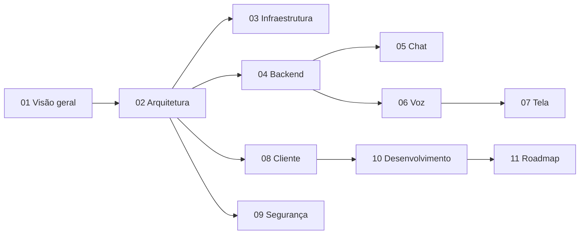

# Documentação do Voxa

Esta pasta descreve o Voxa de ponta a ponta: da infraestrutura até a aplicação que a pessoa usuária abre no navegador ou no desktop.

## Como ler

- **Quer entender o projeto?** Comece por [Visão geral](01-visao-geral.md) e [Arquitetura](02-arquitetura.md).
- **Quer hospedar uma instância?** Vá para [Infraestrutura](03-infraestrutura.md).
- **Quer contribuir com código?** Leia [Desenvolvimento](10-desenvolvimento.md) e o documento da área (backend, cliente, voz…).
- **Por que escolhemos X?** Veja os [ADRs](adr/README.md).

## Índice

1. [Visão geral](01-visao-geral.md)
2. [Arquitetura](02-arquitetura.md)
3. [Infraestrutura](03-infraestrutura.md)
4. [Backend](04-backend.md)
5. [Chat](05-chat.md)
6. [Voz](06-voz.md)
7. [Compartilhamento de tela](07-compartilhamento-de-tela.md)
8. [Aplicação cliente](08-cliente.md)
9. [Segurança e privacidade](09-seguranca-e-privacidade.md)
10. [Desenvolvimento](10-desenvolvimento.md)
11. [Roadmap](11-roadmap.md)
- [Decisões de arquitetura (ADRs)](adr/README.md)
- [Referência: estudo de plataformas existentes](referencia/estudo-discord.md)

## Convenções desta documentação

- Diagramas em [Mermaid](https://mermaid.js.org/), renderizados pelo GitHub.
- Termos em inglês aparecem quando são o nome usual da tecnologia (SFU, WebRTC, gateway).
- Quando algo ainda não foi decidido, o texto diz **"Proposta"** e aponta o ADR correspondente.
