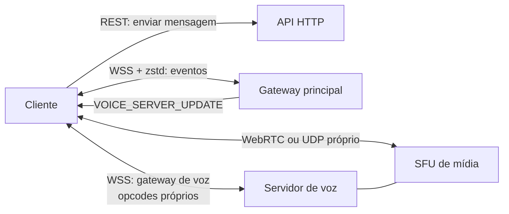
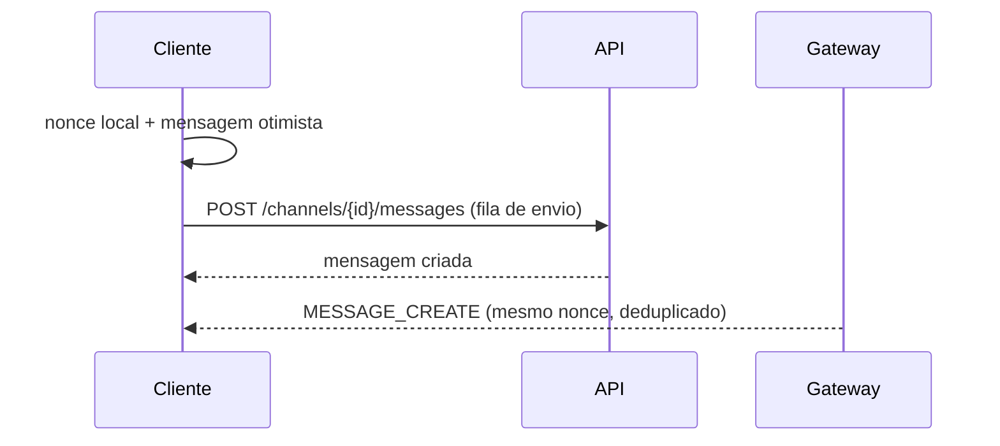
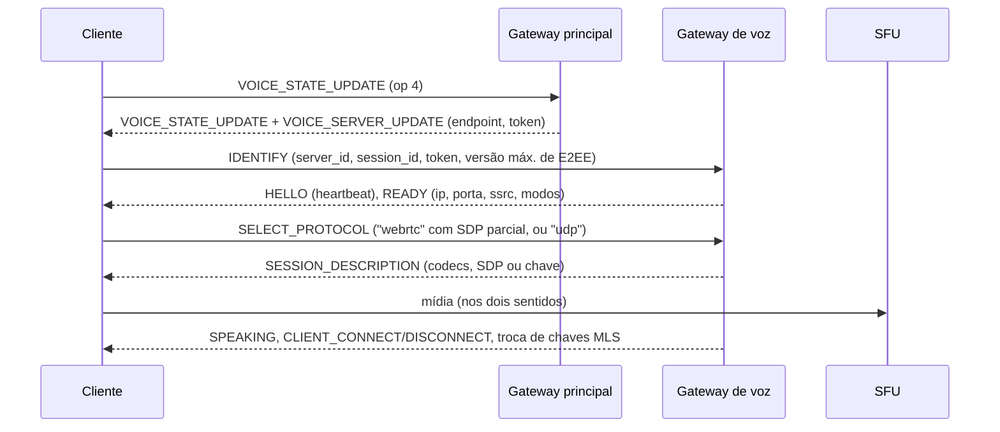

# Referência: como uma plataforma existente implementa chat, voz e tela

> **Propósito:** entender, em nível de arquitetura, as soluções de uma plataforma consolidada para orientar o design do Voxa.
> **Regras:** este documento descreve **conceitos e fluxos**. Nenhum código de terceiros foi ou será copiado para o Voxa, e os protocolos do Voxa são próprios ([Backend §4.6](../04-backend.md#46-gateway-protocolo-em-tempo-real)). Os termos de uso do Discord restringem a engenharia reversa do cliente; esta análise é só referência de design.

## Método

- **Ferramenta:** [REA](https://github.com/morluto/rea) 6.5.0, análise estática dos bundles JavaScript **públicos** do cliente web (`discord.com/app`, build 638651, 2026-10-15). Nada foi executado e não houve login.
- O app desktop oficial para Linux (1.0.162) só traz um *bootstrap* de atualização; o motor de voz nativo é baixado em tempo de execução e **não** foi analisado.
- O REA recuperou os módulos webpack (569 em um chunk; 4 731 no bundle principal, depois de dividido em partes menores). Os trechos relevantes foram lidos por palavras-chave.

## Visão geral

## Chat

**Lição para o Voxa:** envio por REST com fila e `nonce`; recebimento pelo gateway. Adotado em [Chat](../05-chat.md).

## Voz

Observações:

- **Uma única `RTCPeerConnection` por pessoa** com o SFU (`unified-plan`, `max-bundle`), com renegociação a cada entrada ou saída.
- O cliente envia só as linhas essenciais da SDP e **monta localmente a SDP remota** a partir dos campos devolvidos (fingerprint, ICE, candidato).
- Criptografia ponta a ponta de quadros (protocolo "DAVE") com **MLS** para troca de chaves, aplicada por *Insertable Streams* num worker.
- O servidor pode mover a pessoa para outro nó de mídia sem reconectar (`sfu_update`).
- O cancelamento de ruído roda em AudioWorklet.

**Lições para o Voxa:** SFU com uma conexão por pessoa; E2EE com MLS como meta ([Voz §6.8](../06-voz.md#68-criptografia)). Em vez de um gateway de voz próprio, o Voxa usa a sinalização do LiveKit ([ADR-0003](../adr/0003-livekit-como-sfu.md)).

## Compartilhamento de tela

- A transmissão é criada pelo gateway principal (`STREAM_CREATE`) e identificada por uma chave `tipo:servidor:canal:dono`.
- Cada transmissão abre **uma segunda conexão de mídia**, separada da voz.
- Quem quer assistir pede explicitamente (`STREAM_WATCH`).
- Captura com `getDisplayMedia`, com o processamento de voz **desligado** no áudio da tela.
- Ajustes experimentais de `contentHint="motion"` e `degradationPreference`.
- Qualidade (resolução e FPS) **atrelada a assinatura paga** e a impulsos do servidor.

**Lições para o Voxa:** manter "assistir sob demanda" e o processamento de áudio desligado. A diferença deliberada é que **a qualidade é limitada pela capacidade da instância, não por pagamento** ([Tela §7.5](../07-compartilhamento-de-tela.md#75-qualidade--sem-paywall)). Também usamos trilhas na mesma sala em vez de uma segunda conexão.

## Comparação

| Aspecto | Plataforma estudada | Voxa |
|---|---|---|
| Envio de mensagem | REST + nonce | Igual (padrão consolidado) |
| Eventos | Gateway WS próprio, compressão zstd | Gateway WS próprio, compressão zstd |
| Sinalização de voz | Gateway de voz próprio | LiveKit (aberto) |
| Mídia | SFU próprio; UDP nativo no desktop | LiveKit SFU, WebRTC em todos os clientes |
| E2EE de chamadas | MLS (DAVE) | Chave por sala (fase 2) → MLS (fase 4) |
| Tela | Conexão separada por transmissão | Trilha na mesma sala |
| Qualidade da tela | Por assinatura | Por capacidade da instância |
| Código | Fechado | Aberto |
